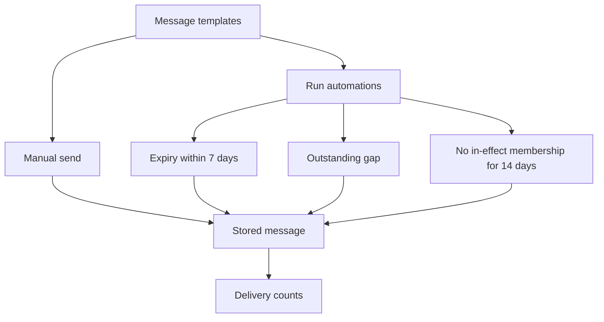

# Communication and Retention Design

## Overview

Phase 6 adds `src/modules/communications/`. Templates are platform rows. A Gym_Owner sends one rendered body to one Member, or runs the three automations. Delivery is a stored `sent` or `failed` status. No package, provider, or cron job is added.

The rules that were not drawn in the diagram, and that implementation will follow unless you change them, are listed at the top of `requirements.md`.

## Architecture

```text
src/
  common/constants/permissions.ts
  modules/communications/
    message-values.ts
    message-render.ts
    communications.service.ts
    message-templates.controller.ts
    gym-communications.controller.ts
    communications.module.ts
```

`CommunicationsModule` imports `GymsModule`. It reads memberships and payments through Prisma. It does not import `MembersModule` or `FinanceModule`. `AppModule` imports `CommunicationsModule` and stays a composition root.



## Routes

| Route | Permission | Success |
| --- | --- | --- |
| `GET /message-templates` | `manage_message_templates` | 200 |
| `POST /message-templates` | `manage_message_templates` | 201 |
| `PATCH /message-templates/:id` | `manage_message_templates` | 200 |
| `GET /communications/analytics` | `manage_message_templates` | 200 |
| `GET /gym-communications/messages` | `manage_communications` | 200 |
| `POST /gym-communications/messages` | `manage_communications` | 201 |
| `GET /gym-communications/automations` | `manage_communications` | 200 |
| `PUT /gym-communications/automations` | `manage_communications` | 200 |
| `POST /gym-communications/run` | `manage_communications` | 200 |

The permission map points `manage_message_templates` at `GET /message-templates` and `manage_communications` at `GET /gym-communications/messages`.

`manage_message_templates` is locked on Super_Admin with the message `manage_message_templates cannot be disabled on Super_Admin`. `manage_communications` is enabled on Gym_Owner only and is not locked.

## Templates

`parseTemplate` accepts `channel` of `whatsapp`, `sms`, or `push`, `name` of 1 to 64 characters with a non-whitespace character, and `body` of 1 to 500 characters. `isActive` defaults to true on create. The body may include only these tokens:

```text
{{memberName}} {{gymName}} {{endDate}} {{unpaidAmount}}
```

A `{{` that is not one of those four tokens is 400 `Message template values are not valid`. An update cannot change `channel`. A duplicate channel plus name is 409 `Message template name is already used`. A missing id is 404 `Message template was not found`.

List order is `createdAt` ascending, then `id`.

## Rendering and delivery

`renderBody` replaces the four tokens. `memberName` is the Member full name. `gymName` is the Gym name or an empty string. `endDate` is the Membership `currentPeriodEnd` as `YYYY-MM-DD` in UTC, or empty when there is no Membership. `unpaidAmount` is the Member's outstanding gap formatted as rupees with two decimals, such as `12.50`. The gap uses the Phase 5 rule `max(0, listPricePaise - amountReceivedPaise)` summed across that Member's payments.

After render:

- `whatsapp` and `sms` are `sent` when the contact has at least 8 digits. Otherwise `failed` and `failureReason` is `Contact cannot receive this channel`.
- `push` is always `failed` and `failureReason` is `Member has no push destination`.

A left Member, a Member from another Gym, or an inactive or missing template is rejected before insert: 404 `Member was not found` or 404 `Message template was not found` or 409 `Message template is not active`. A left Member uses 409 `Member has left`. No Gym is 404 `Gym was not found`. A Gym that is not `active` is 409 `Communication requires an active gym`.

## Automations

The stored triggers are `expiry`, `payment`, and `inactive`. The GET response always has three objects:

```json
{
  "automations": [
    { "trigger": "expiry", "enabled": false, "templateId": null },
    { "trigger": "payment", "enabled": false, "templateId": null },
    { "trigger": "inactive", "enabled": false, "templateId": null }
  ]
}
```

PUT accepts one or more of those triggers. Each value is `{ "enabled": false }` or `{ "enabled": true, "templateId": "uuid" }`. Enabling requires an active template. The channel of the template is the channel used at run time, so one trigger has one channel.

Selection at run time, for Members of the caller's Gym who are not left:

- `expiry`: Membership stored state `active`, `frozenAt` null, `currentPeriodEnd > now`, and `currentPeriodEnd <= now + 7 days`.
- `payment`: outstanding gap greater than 0.
- `inactive`: no frozen Membership, and either no Membership whose `createdAt <= now - 14 days`, or a non-frozen Membership whose `currentPeriodEnd <= now - 14 days`.

The run inserts inside one transaction, oldest due Member first by `createdAt` then `id`, and stops at 100 inserts. The unique key `(gym_id, member_id, trigger, sent_on)` where `trigger <> 'manual'` makes a second run on the same UTC day a no-op for that pair. `sent_on` is the UTC date of the run. A unique violation on that key is skipped, not a 409 for the whole run.

Response:

```json
{ "stored": 3, "remaining": 12 }
```

## Messages and analytics

Gym message list uses the Phase 5 date range parser and its error `Finance range is not valid`. Order is `createdAt` descending, then `id` descending.

```json
{
  "id": "…",
  "memberId": "…",
  "memberName": "Asha Rao",
  "channel": "sms",
  "trigger": "manual",
  "status": "sent",
  "failureReason": null,
  "body": "Hi Asha Rao",
  "createdAt": "2026-11-23T10:00:00.000Z"
}
```

Analytics count rows whose `createdAt` is in the range. The body is:

```json
{
  "sent": 4,
  "failed": 1,
  "channels": [
    { "channel": "whatsapp", "sent": 2, "failed": 0 },
    { "channel": "sms", "sent": 2, "failed": 0 },
    { "channel": "push", "sent": 0, "failed": 1 }
  ]
}
```

The three channels are always present, with zeroes when empty.

## Data model

New migration `prisma/migrations/<timestamp>_communication_retention`. Do not edit earlier migrations.

```prisma
enum MessageChannel {
  whatsapp
  sms
  push

  @@map("message_channel")
}

enum MessageTrigger {
  manual
  expiry
  payment
  inactive

  @@map("message_trigger")
}

enum MessageStatus {
  sent
  failed

  @@map("message_status")
}

model MessageTemplate {
  id        String         @id @default(uuid()) @db.Uuid
  channel   MessageChannel
  name      String         @db.Text
  body      String         @db.Text
  isActive  Boolean        @default(true) @map("is_active")
  createdAt DateTime       @default(now()) @map("created_at") @db.Timestamptz(3)
  messages  Message[]
  automations GymAutomation[]

  @@unique([channel, name])
  @@map("message_templates")
}

model GymAutomation {
  id         String          @id @default(uuid()) @db.Uuid
  gymId      String          @map("gym_id") @db.Uuid
  trigger    MessageTrigger
  templateId String          @map("template_id") @db.Uuid
  enabled    Boolean         @default(false)
  gym        Gym             @relation(fields: [gymId], references: [id], onDelete: Restrict)
  template   MessageTemplate @relation(fields: [templateId], references: [id], onDelete: Restrict)

  @@unique([gymId, trigger])
  @@map("gym_automations")
}

model Message {
  id            String          @id @default(uuid()) @db.Uuid
  gymId         String          @map("gym_id") @db.Uuid
  memberId      String          @map("member_id") @db.Uuid
  templateId    String          @map("template_id") @db.Uuid
  channel       MessageChannel
  trigger       MessageTrigger
  status        MessageStatus
  failureReason String?         @map("failure_reason") @db.Text
  body          String          @db.Text
  sentOn        DateTime        @map("sent_on") @db.Date
  createdAt     DateTime        @default(now()) @map("created_at") @db.Timestamptz(3)
  gym           Gym             @relation(fields: [gymId], references: [id], onDelete: Restrict)
  member        Member          @relation(fields: [memberId], references: [id], onDelete: Restrict)
  template      MessageTemplate @relation(fields: [templateId], references: [id], onDelete: Restrict)

  @@unique([gymId, memberId, trigger, sentOn], map: "messages_one_automation_per_day", where: { trigger: { not: "manual" } })
  @@index([gymId, createdAt])
  @@map("messages")
}
```

Prisma cannot express a partial unique index in the schema shown above if the preview feature is already on. This project already uses `previewFeatures = ["partialIndexes"]`. Use that form. If the generator rejects `where` on `@@unique`, put the unique index only in the SQL migration and keep a normal index in Prisma. The migration SQL is the authority:

```sql
CREATE UNIQUE INDEX "messages_one_automation_per_day"
  ON "messages" ("gym_id", "member_id", "trigger", "sent_on")
  WHERE "trigger" <> 'manual';
```

Also append:

```sql
ALTER TABLE "message_templates" ADD CONSTRAINT "message_templates_values_check" CHECK (
  char_length("name") BETWEEN 1 AND 64
  AND char_length("body") BETWEEN 1 AND 500
);

ALTER TABLE "messages" ADD CONSTRAINT "messages_status_check" CHECK (
  ("status" = 'sent' AND "failure_reason" IS NULL)
  OR ("status" = 'failed' AND "failure_reason" IS NOT NULL)
);

ALTER TABLE "gym_automations" ADD CONSTRAINT "gym_automations_trigger_check" CHECK (
  "trigger" IN ('expiry', 'payment', 'inactive')
);
```

`Gym`, `Member`, and the template relation fields are additions only. The e2e `TRUNCATE` lists `messages` and `gym_automations` before `members` and `message_templates`.

## Testing

Unit tests cover placeholder rejection, digit counting, render output, the 7-day and 14-day selectors, and the 100-message cap. E2E covers each error once, a second same-day run that stores nothing new, analytics hiding bodies, and a staff token rejected from both roots.

Properties:

1. WhatsApp and SMS are sent only when the contact has at least 8 digits. Push is never sent.
2. A second automation run on the same UTC day does not add a Message for the same Member and trigger.
3. Analytics counts equal the stored sent and failed rows and contain no body text.

## Phase impact

- `GET /roles` grows by two permission names.
- Member, finance, and subscription responses do not change.
- No provider client is added.
- `AI_RULES.md` gains §67 during planning. Implementation tasks stay open.
