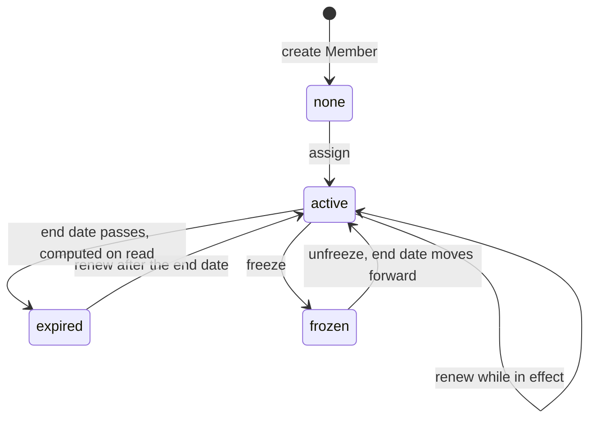

# Core Gym Management Design

## Overview

Phase 3 adds one NestJS module, `src/modules/members/`, to the existing ESM API. It stores Members, Membership_Products, and at most one Membership per Member. It reads `maxMembers` through the existing `SubscriptionsService.entitlementsForGym` and does not change Plans, Subscriptions, or Gym status.

Attendance, QR, Super_Admin monitoring, revenue, and usage are out of scope. No package is added.

Confirmed decisions and the testability rules are in `requirements.md`. The rules that were not in the roadmap, and that implementation will follow unless you change them, are:

- Renew does not switch product. An expired renew starts at now. An in-effect renew extends the stored end.
- Assign and renew copy the product name, price, and duration onto the Membership.
- Duration is 24-hour days, from 1 to 3650.
- Freeze is one nullable timestamp on the Membership, not a history table.
- There is no delete.
- Every route requires an `active` Gym.

## Architecture

```text
src/
  common/constants/permissions.ts          (+ manage_members)
  modules/members/
    dto/
    member-values.ts                       (pure validation)
    membership-state.ts                    (pure status and period math)
    members.controller.ts
    membership-products.controller.ts
    members.service.ts
    members.module.ts
```

`MembersModule` imports `GymsModule` and `SubscriptionsModule`. `AppModule` imports `MembersModule` and stays a composition root. `entitlementsForGym` gains an optional transaction client so the seat check can run on the same connection as the Gym lock. Its result shape does not change.

Every handler uses `@RequirePermission('manage_members')`. Owner identity comes from the session. The service loads the Gym with `GymsService.getMine` and then requires `status === 'active'`.



`expired` is not stored. The stored states are `active` and `frozen`.

### Concurrency

Member create, assign, renew, freeze, and unfreeze lock the Gym row inside one interactive transaction, the same way Subscription writes do:

```ts
await tx.$queryRaw`SELECT "id" FROM "gyms" WHERE "id" = ${gymId}::uuid FOR UPDATE`;
```

Member create then counts Members for that Gym and reads entitlements. Two creates that would exceed `maxMembers` store only as many as the limit allows. The second waits on the lock, recounts, and returns 409 `Member limit reached`.

## Components and Interfaces

### Permission

Append `manage_members` to `PERMISSIONS` after `manage_gym_subscription`. `PlatformSeedService` adds it to `GYM_OWNER_ENABLED` only. The RolePermission backfill already loads every Role, so existing databases gain one disabled or enabled row per Role without changing saved states. `manage_members` is not added to the Super_Admin lock set.

| Route | Permission | Success |
| --- | --- | --- |
| `GET /members` | `manage_members` | 200 |
| `POST /members` | `manage_members` | 201 |
| `PATCH /members/:id` | `manage_members` | 200 |
| `GET /membership-products` | `manage_members` | 200 |
| `POST /membership-products` | `manage_members` | 201 |
| `PATCH /membership-products/:id` | `manage_members` | 200 |
| `POST /members/:id/membership` | `manage_members` | 201 |
| `POST /members/:id/membership/renew` | `manage_members` | 200 |
| `POST /members/:id/membership/freeze` | `manage_members` | 200 |
| `POST /members/:id/membership/unfreeze` | `manage_members` | 200 |

`GET /members` is declared before `PATCH /members/:id`. Membership action routes are declared on the Member id.

### Validation

`member-values.ts`:

- `fullName`: string, length 1 to 100, at least one character outside U+0020, tab, CR, and LF. Stored exactly.
- `contact`: string, length 1 to 254, same non-whitespace rule. It does not have to be a phone number or an email.
- `notes`: omitted or `null` means no notes and is stored as `null`. A submitted string must have length 0 to 1000 and is stored exactly, including whitespace.

`parseCreateMember` requires full name and contact. `parseUpdateMember` requires at least one of the three fields. Both throw 400 `Member values are not valid`.

`parseCreateProduct` and `parseUpdateProduct`:

- `name`: string, length 1 to 64, same non-whitespace rule.
- `pricePaise`: integer 0 to 2,147,483,647.
- `durationDays`: integer 1 to 3650.
- `isActive`: boolean, default `true` on create.

Failures throw 400 `Membership product values are not valid`. DTOs carry that message on their type decorators, the same way Plan DTOs do. `PlatformExceptionFilter` already collapses repeated messages.

### Time and status

`membership-state.ts`, all taking `now: Date`:

- `addDays(from, days)`: `from + days × 86,400,000` ms.
- `isInEffect(row, now)`: stored state `active` and `currentPeriodEnd > now`.
- `reportedStatus(row, now)`: `frozen` when the stored state is `frozen`, otherwise `active` or `expired`.
- `unfreezeEnd(row, now)`: `currentPeriodEnd + (now - frozenAt)`.

Renew:

- In effect: new end is `addDays(currentPeriodEnd, product.durationDays)`. Start stays.
- Expired (`active` and not in effect): start is `now`, end is `addDays(now, product.durationDays)`.
- The snapshot written on assign and renew is `{ productName, pricePaise, durationDays }` from the product row at that time.

### Responses

Member:

```json
{
  "id": "…",
  "fullName": "Asha Rao",
  "contact": "555-0100",
  "notes": null,
  "createdAt": "2026-11-22T10:00:00.000Z",
  "membership": null
}
```

`membership`, when present:

```json
{
  "id": "…",
  "status": "active",
  "productId": "…",
  "productName": "Monthly",
  "pricePaise": 150000,
  "durationDays": 30,
  "currentPeriodStart": "2026-11-22T10:00:00.000Z",
  "currentPeriodEnd": "2026-12-22T10:00:00.000Z",
  "frozenAt": null
}
```

While frozen, `status` is `frozen` and `frozenAt` is the freeze start. Product name, price, and duration in this object are the snapshot, not the product's current values.

Product:

```json
{
  "id": "…",
  "name": "Monthly",
  "pricePaise": 150000,
  "durationDays": 30,
  "isActive": true,
  "createdAt": "2026-11-22T10:00:00.000Z"
}
```

Lists are `{ "members": [...] }` and `{ "products": [...] }`, ordered by `createdAt` then `id` ascending.

### Service rules

Shared guard used by every method:

1. `gym = gymsService.getMine(ownerId)`. Missing Gym stays 404 `Gym was not found`.
2. `gym.status !== 'active'` throws 409 `Member management requires an active gym`.

`createMember`: parse, then in a transaction lock the Gym, call `entitlementsForGym(gym.id, now, tx)`, count Members, and insert only when `maxMembers === null` or `count < maxMembers`. Otherwise 409 `Member limit reached`.

`updateMember`: parse, `updateMany` where `id` and `gymId`. Count 0 is 404 `Member was not found`. Do not write the Membership.

`assign`: body `{ "productId": string }`. `productId` must be a UUID of an active product of this Gym. Unknown or other-gym or inactive product is 404 `Membership product was not found` when missing, and 409 `Membership product is not active` when the row exists, belongs to this Gym, and `isActive` is false. A product of another Gym is 404, not 403. If the Member already has a Membership, 409 `Member already has a membership`. Insert the `active` row with the snapshot and `addDays(now, durationDays)`.

`renew`: load the Membership. None is 409 `Member has no membership`. `frozen` is 409 `Membership is frozen`. Read the linked product even if it is inactive. Apply the renew rule above. Do not change `productId`.

`freeze`: 409 `Only an active membership can be frozen` unless the Membership is In_Effect. Set `status = frozen` and `frozenAt = now`.

`unfreeze`: 409 `Membership is not frozen` unless the stored state is `frozen` and `frozenAt` is set. Set `status = active`, `currentPeriodEnd = unfreezeEnd(...)`, and `frozenAt = null`.

Member id checks use `isUUID` before querying. A malformed id is 404 `Member was not found`.

## Data Models

New migration `prisma/migrations/<timestamp>_core_gym_management`. Do not edit earlier migrations.

```prisma
enum MembershipState {
  active
  frozen

  @@map("membership_state")
}

model Member {
  id         String       @id @default(uuid()) @db.Uuid
  gymId      String       @map("gym_id") @db.Uuid
  fullName   String       @map("full_name") @db.Text
  contact    String       @db.Text
  notes      String?      @db.Text
  createdAt  DateTime     @default(now()) @map("created_at") @db.Timestamptz(3)
  gym        Gym          @relation(fields: [gymId], references: [id], onDelete: Restrict)
  membership Membership?

  @@index([gymId])
  @@map("members")
}

model MembershipProduct {
  id           String       @id @default(uuid()) @db.Uuid
  gymId        String       @map("gym_id") @db.Uuid
  name         String       @db.Text
  pricePaise   Int          @map("price_paise")
  durationDays Int          @map("duration_days")
  isActive     Boolean      @default(true) @map("is_active")
  createdAt    DateTime     @default(now()) @map("created_at") @db.Timestamptz(3)
  gym          Gym          @relation(fields: [gymId], references: [id], onDelete: Restrict)
  memberships  Membership[]

  @@index([gymId])
  @@map("membership_products")
}

model Membership {
  id                 String             @id @default(uuid()) @db.Uuid
  memberId           String             @unique @map("member_id") @db.Uuid
  productId          String             @map("product_id") @db.Uuid
  gymId              String             @map("gym_id") @db.Uuid
  status             MembershipState    @default(active)
  productName        String             @map("product_name") @db.Text
  pricePaise         Int                @map("price_paise")
  durationDays       Int                @map("duration_days")
  currentPeriodStart DateTime           @map("current_period_start") @db.Timestamptz(3)
  currentPeriodEnd   DateTime           @map("current_period_end") @db.Timestamptz(3)
  frozenAt           DateTime?          @map("frozen_at") @db.Timestamptz(3)
  createdAt          DateTime           @default(now()) @map("created_at") @db.Timestamptz(3)
  member             Member             @relation(fields: [memberId], references: [id], onDelete: Restrict)
  product            MembershipProduct  @relation(fields: [productId], references: [id], onDelete: Restrict)

  @@index([gymId])
  @@map("memberships")
}
```

`Gym` gains relation fields only. Append CHECK constraints the same way Phase 2 did, because Prisma does not model them:

```sql
ALTER TABLE "members" ADD CONSTRAINT "members_values_check" CHECK (
  char_length("full_name") BETWEEN 1 AND 100
  AND char_length("contact") BETWEEN 1 AND 254
  AND ("notes" IS NULL OR char_length("notes") <= 1000)
);

ALTER TABLE "membership_products" ADD CONSTRAINT "membership_products_values_check" CHECK (
  char_length("name") BETWEEN 1 AND 64
  AND "price_paise" >= 0
  AND "duration_days" BETWEEN 1 AND 3650
);

ALTER TABLE "memberships" ADD CONSTRAINT "memberships_state_check" CHECK (
  "current_period_end" >= "current_period_start"
  AND "duration_days" BETWEEN 1 AND 3650
  AND "price_paise" >= 0
  AND (
    ("status" = 'active' AND "frozen_at" IS NULL)
    OR ("status" = 'frozen' AND "frozen_at" IS NOT NULL)
  )
);
```

`members.gym_id` on `memberships` is copied from the Member so a seat count and a Gym lock do not need a join, and so a product from another Gym cannot be attached. The service writes the Member's `gymId`. A mismatch with the product's Gym is a failed assign, not a stored row.

The e2e `TRUNCATE` in `test/helpers/gym-platform.ts` must include `"members"`, `"membership_products"`, and `"memberships"`. Truncate members after memberships, or keep using `CASCADE`.

## Correctness Properties

### Property 1: Seat limit blocks creates only

For any `maxMembers` of `null` or a number from 0 to 5, and any set of existing Members, a create succeeds only when `maxMembers` is `null` or the count is below it. Failed creates write nothing. Updates of existing Members succeed even when the count is above a later, lower `maxMembers`.

**Validates: Requirements 2.5, 2.6, 2.7, 3.6**

### Property 2: One Membership, and renew follows the period

For any Member, the second assign is rejected and the row is unchanged. For any in-effect end and any duration, renew sets the end to `addDays(end, duration)` and keeps the start. For any expired end, renew sets the start to `now` and the end to `addDays(now, duration)`. Frozen renew writes nothing.

**Validates: Requirements 5.2, 6.1, 6.2, 6.4**

### Property 3: Freeze pauses the clock

For any in-effect Membership and any freeze length, freeze does not change the end. Unfreeze moves the end forward by exactly that length and clears `frozenAt`. A frozen Membership is reported `frozen` even when the stored end is before `now`.

**Validates: Requirements 7.1, 7.2, 8.2**

### Property 4: Owners cannot cross Gyms

For any two Gyms, a caller sees and writes only Members and products of their own Gym. A Member id, product id, or assign from the other Gym is rejected and changes nothing.

**Validates: Requirements 3.4, 4.4, 9.2**

## Error Handling

| Condition | Status | Message |
| --- | --- | --- |
| Invalid Member field, or update with no fields | 400 | `Member values are not valid` |
| Invalid product field, or product update with no fields | 400 | `Membership product values are not valid` |
| Caller has no Gym | 404 | `Gym was not found` |
| Gym is not `active` | 409 | `Member management requires an active gym` |
| `maxMembers` reached, including 0 | 409 | `Member limit reached` |
| Member id missing, malformed, or not in this Gym | 404 | `Member was not found` |
| Product id missing, malformed, inactive on assign, or not in this Gym | 404 or 409 | `Membership product was not found` or `Membership product is not active` |
| Assign when a Membership exists | 409 | `Member already has a membership` |
| Renew or freeze with no Membership | 409 | `Member has no membership` |
| Renew while frozen | 409 | `Membership is frozen` |
| Freeze when not in effect | 409 | `Only an active membership can be frozen` |
| Unfreeze when not frozen | 409 | `Membership is not frozen` |
| Permission missing, or no token | 403 / 401 | Phase 1 messages |

Assign reports 404 `Membership product was not found` when the id is missing, malformed, or not a product of this Gym. It reports 409 `Membership product is not active` only when the product belongs to this Gym and `isActive` is false.

## Testing Strategy

Unit tests cover `member-values.ts`, `membership-state.ts`, and `MembersService` with a mocked Prisma client and a mocked `entitlementsForGym`. Time-based tests use `vi.useFakeTimers({ toFake: ['Date'] })`.

E2E tests use `test/helpers/gym-platform.ts` and the local embedded Postgres only. They never read `DATABASE_URL` from `.env`. Cover the error table once, the seat limit under two concurrent creates, owner isolation, freeze then unfreeze, and renew of an expired Membership by moving `current_period_end` backward rather than faking the clock.

Properties 2 and 3 can be unit tests. Properties 1 and 4 are e2e tests.

## Phase 1 and Phase 2 impact

- `GET /roles` grows from 11 permission states to 12.
- `GET /auth/me` can include `manage_members`.
- `entitlementsForGym` accepts an optional transaction client. Callers that omit it behave as they do now.
- No Plan, Subscription, or Gym route changes.
- `AI_RULES.md` gains a Phase 3 section during implementation, the same way Phase 2 added §63. Members, attendance, and extra dashboard metrics stay forbidden outside that section.
