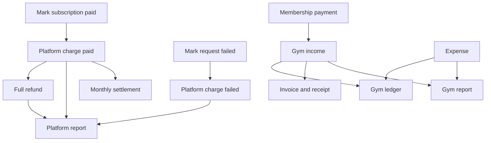

# Finance and Billing Design

## Overview

Phase 5 adds `src/modules/finance/`. Platform charges are written from the existing mark-paid transaction. Gym income is the membership payments already stored. Expenses are new rows. The ledger, outstanding balance, invoice, receipt, and both reports are computed on read. No package is added. No payment gateway is added.

The rules that were not drawn in the diagram, and that implementation will follow unless you change them, are listed at the top of `requirements.md`.

## Architecture

```text
src/
  common/constants/permissions.ts          (+ two permissions)
  config/configuration.ts                  (+ commissionPercent)
  modules/finance/
    finance-values.ts
    finance.service.ts
    platform-finance.controller.ts
    gym-finance.controller.ts
    finance.module.ts
  modules/subscriptions/subscriptions.service.ts
                                           (write a charge inside markPaid)
```

`FinanceModule` exports `FinanceService`. `SubscriptionsModule` imports `FinanceModule`. `FinanceModule` does not import `SubscriptionsModule`. `AppModule` imports `FinanceModule` and stays a composition root.

`markPaid` calls `finance.recordPaidCharge(tx, ...)` after the subscription update, in the same transaction. A rejected mark-paid throws before that write.



## Routes

| Route | Permission | Success |
| --- | --- | --- |
| `GET /platform-finance/payments` | `manage_platform_finance` | 200 |
| `POST /platform-finance/payments/:id/refund` | `manage_platform_finance` | 200 |
| `POST /platform-finance/subscriptions/:id/fail` | `manage_platform_finance` | 200 |
| `GET /platform-finance/settlements` | `manage_platform_finance` | 200 |
| `POST /platform-finance/settlements` | `manage_platform_finance` | 201 |
| `GET /platform-finance/report` | `manage_platform_finance` | 200 |
| `GET /gym-finance/income` | `manage_gym_finance` | 200 |
| `GET /gym-finance/expenses` | `manage_gym_finance` | 200 |
| `POST /gym-finance/expenses` | `manage_gym_finance` | 201 |
| `GET /gym-finance/outstanding` | `manage_gym_finance` | 200 |
| `GET /gym-finance/ledger` | `manage_gym_finance` | 200 |
| `GET /gym-finance/payments/:id/invoice` | `manage_gym_finance` | 200 |
| `GET /gym-finance/payments/:id/receipt` | `manage_gym_finance` | 200 |
| `GET /gym-finance/report` | `manage_gym_finance` | 200 |

`GET /platform-finance/payments` accepts an optional `status` of `paid`, `failed`, or `refunded`. Any other value is 400 `Finance filter is not valid`.

Mark paid stays `POST /subscriptions/:id/mark-paid` with `manage_subscriptions`.

## Permission

Append the two names to `PERMISSIONS`. Add `manage_platform_finance` to `SUPER_ADMIN_ENABLED` and to a new lock set with its own message:

`manage_platform_finance cannot be disabled on Super_Admin`

Add `manage_gym_finance` to `GYM_OWNER_ENABLED` only. Do not add either name to a staff flag. The permission-enforcement map points `manage_platform_finance` at `GET /platform-finance/report` and `manage_gym_finance` at `GET /gym-finance/income`.

`configuration.ts` adds `commissionPercent`. Missing or blank is 0. A value that is not a canonical integer from 0 to 100 throws at startup: `COMMISSION_PERCENT is not a whole number from 0 to 100`.

## Charge write

`recordPaidCharge` inserts one row:

- `amountPaise` = the subscription `priceMonthlyPaise` just saved
- `commissionPercent` = the configured percent
- `commissionPaise` = `Math.floor(amountPaise * commissionPercent / 100)`
- `status` = `paid`
- `recordedAt` = the same `now` as the subscription update

`failSubscription` locks the Gym, loads the subscription, and continues only when `status` is `pending_payment`. It sets `status` to `failed` and inserts a charge for `plan.priceMonthlyPaise` with commission 0 and status `failed`. Any other status is 409 `Only a pending payment can be marked failed`.

`refund` locks nothing beyond the charge row. Status must be `paid`. It sets `refundedAt` and `status` to `refunded`. A second refund is 409 `Platform charge is already refunded`. A failed charge is 409 `Platform charge cannot be refunded`. Missing or a bad id is 404 `Platform charge was not found`.

Entitlements and current-subscription queries already limit themselves to `trialing` and `active`. Leave `failed` out of those filters. Do not add `failed` to the partial unique index for pending payments.

## Settlement

Body `{ "month": "YYYY-MM" }`. The month is parsed as a UTC calendar month. `month + "-01"` must be a real date, and the month must be less than or equal to the current UTC month. The amount is:

```text
sum(commissionPaise) where status = paid
  and recordedAt >= month start
  and recordedAt < next month start
```

A duplicate month is 409 `Settlement already exists`. An invalid month is 400 `Settlement month is not valid`.

## Gym reads

Shared guard:

1. `gymsService.getMine(ownerId)`. Missing Gym stays 404 `Gym was not found`.
2. Status other than `active` is 409 `Gym finance requires an active gym`.

Income reads `membership_payments` for that `gymId` and joins member and product snapshot fields already stored on the payment (`listPricePaise`, `amountReceivedPaise`, `paidOn`, `method`).

Outstanding groups by `memberId`. Gap is `max(0, listPricePaise - amountReceivedPaise)`. Members with a zero total are omitted.

Ledger lines in the range use `paidOn` for both income and expenses. Sort by date ascending, then kind (`expense` before `income` on the same date), then id. Running balance starts at 0 and adds income or subtracts expense.

Invoice and receipt look up the payment by id and `gymId`. A bad id or another gym is 404 `Payment was not found`.

Date ranges use `parseFinanceRange`. `from` and `to` are `YYYY-MM-DD`, `from <= to`, and the inclusive day count is at most 366. Otherwise 400 `Finance range is not valid`. Compare them as dates, not as timestamps that depend on the server's local zone. A payment date equals `paidOn`. A charge falls in the range when its `recordedAt` or, for refunds, its `refundedAt`, is in `[from 00:00:00.000Z, to + 1 day 00:00:00.000Z)`.

Platform report:

- `revenuePaise`: sum of `amountPaise` for charges recorded in range whose status is `paid` or `refunded`
- `refundedPaise`: sum of `amountPaise` for charges whose `refundedAt` is in range
- `commissionPaise`: sum of `commissionPaise` for charges recorded in range whose status is still `paid`
- `failedPaise` and `failedCount`: `failed` charges recorded in range
- `netPaise`: `revenuePaise - refundedPaise`

Gym report:

- `incomePaise`: sum of `amountReceivedPaise` with `paidOn` in range
- `expensePaise`: sum of expense amounts with `paidOn` in range
- `netPaise`: income minus expense
- `outstandingPaise`: outstanding from payments with `paidOn <= to`

## Responses

Platform charge:

```json
{
  "id": "…",
  "gymId": "…",
  "subscriptionId": "…",
  "amountPaise": 100000,
  "commissionPercent": 10,
  "commissionPaise": 10000,
  "status": "paid",
  "recordedAt": "2026-11-22T10:00:00.000Z",
  "refundedAt": null
}
```

Settlement:

```json
{
  "id": "…",
  "month": "2026-11",
  "amountPaise": 10000,
  "settledAt": "2026-11-22T10:00:00.000Z"
}
```

Expense:

```json
{
  "id": "…",
  "category": "Rent",
  "amountPaise": 500000,
  "paidOn": "2026-11-22",
  "notes": null,
  "createdAt": "2026-11-22T10:00:00.000Z"
}
```

Lists are `{ "payments": [] }`, `{ "settlements": [] }`, `{ "expenses": [] }`, `{ "entries": [] }`, and `{ "members": [] }` for outstanding. Reports are one object, not a list.

## Data model

New migration `prisma/migrations/<timestamp>_finance_billing`. Do not edit earlier migrations. Add `failed` to `SubscriptionStatus`.

```prisma
enum PlatformChargeStatus {
  paid
  failed
  refunded

  @@map("platform_charge_status")
}

model PlatformCharge {
  id                 String               @id @default(uuid()) @db.Uuid
  gymId              String               @map("gym_id") @db.Uuid
  subscriptionId     String               @map("subscription_id") @db.Uuid
  amountPaise        Int                  @map("amount_paise")
  commissionPercent  Int                  @map("commission_percent")
  commissionPaise    Int                  @map("commission_paise")
  status             PlatformChargeStatus
  recordedAt         DateTime             @map("recorded_at") @db.Timestamptz(3)
  refundedAt         DateTime?            @map("refunded_at") @db.Timestamptz(3)
  gym                Gym                  @relation(fields: [gymId], references: [id], onDelete: Restrict)
  subscription       Subscription         @relation(fields: [subscriptionId], references: [id], onDelete: Restrict)

  @@index([gymId, recordedAt])
  @@index([status, recordedAt])
  @@map("platform_charges")
}

model Expense {
  id          String   @id @default(uuid()) @db.Uuid
  gymId       String   @map("gym_id") @db.Uuid
  category    String   @db.Text
  amountPaise Int      @map("amount_paise")
  paidOn      DateTime @map("paid_on") @db.Date
  notes       String?  @db.Text
  createdAt   DateTime @default(now()) @map("created_at") @db.Timestamptz(3)
  gym         Gym      @relation(fields: [gymId], references: [id], onDelete: Restrict)

  @@index([gymId, paidOn])
  @@map("expenses")
}

model Settlement {
  id          String      @id @default(uuid()) @db.Uuid
  month       String      @unique @db.Text
  amountPaise Int         @map("amount_paise")
  settledAt   DateTime    @default(now()) @map("settled_at") @db.Timestamptz(3)
  actorUserId String      @map("actor_user_id") @db.Uuid
  actor       UserAccount @relation(fields: [actorUserId], references: [id], onDelete: Restrict)

  @@map("settlements")
}
```

`Gym`, `Subscription`, and `UserAccount` gain relation fields only.

```sql
ALTER TABLE "platform_charges" ADD CONSTRAINT "platform_charges_values_check" CHECK (
  "amount_paise" >= 0
  AND "commission_percent" BETWEEN 0 AND 100
  AND "commission_paise" >= 0
  AND "commission_paise" <= "amount_paise"
  AND (
    ("status" = 'refunded' AND "refunded_at" IS NOT NULL)
    OR ("status" IN ('paid', 'failed') AND "refunded_at" IS NULL)
  )
);

ALTER TABLE "expenses" ADD CONSTRAINT "expenses_values_check" CHECK (
  char_length("category") BETWEEN 1 AND 64
  AND "amount_paise" >= 1
  AND ("notes" IS NULL OR char_length("notes") <= 500)
);

ALTER TABLE "settlements" ADD CONSTRAINT "settlements_month_check" CHECK (
  "month" ~ '^[0-9]{4}-(0[1-9]|1[0-2])$'
  AND "amount_paise" >= 0
);
```

The e2e `TRUNCATE` lists `platform_charges` and `expenses` before `subscriptions` and `gyms`, and lists `settlements` before `user_accounts`.

## Error handling

| Condition | Status | Message |
| --- | --- | --- |
| Bad finance filter | 400 | `Finance filter is not valid` |
| Bad date range | 400 | `Finance range is not valid` |
| Bad expense | 400 | `Expense values are not valid` |
| Bad settlement month | 400 | `Settlement month is not valid` |
| Duplicate settlement month | 409 | `Settlement already exists` |
| Charge missing | 404 | `Platform charge was not found` |
| Refund a failed charge | 409 | `Platform charge cannot be refunded` |
| Refund twice | 409 | `Platform charge is already refunded` |
| Fail anything except `pending_payment` | 409 | `Only a pending payment can be marked failed` |
| No Gym | 404 | `Gym was not found` |
| Gym not `active` | 409 | `Gym finance requires an active gym` |
| Payment not in this Gym | 404 | `Payment was not found` |
| Locked permission | 400 | `manage_platform_finance cannot be disabled on Super_Admin` |
| Permission missing, or no token | 403 / 401 | Phase 1 messages |

Mark-paid errors stay the Phase 2 strings. A successful mark-paid response body does not grow a charge field.

## Testing

Unit tests cover `finance-values.ts`, commission math, outstanding gaps, ledger running balance, and the charge insert using a mocked transaction. E2E tests use the local database only.

`test/phase5-examples.e2e-spec.ts` covers each error once, a mark-paid that stores one charge, a refund that does not move `currentPeriodEnd`, a failed request that still allows a new plan request, and a gym owner who cannot read platform finance.

Properties:

1. Commission is `floor(amount * percent / 100)` and a later percent does not change a stored charge.
2. Outstanding ignores negative gaps and other gyms.
3. A ledger's final balance equals income minus expense for that range.

## Phase impact

- `GET /roles` grows by two permission names.
- `SubscriptionStatus` gains `failed`. Existing readers of `trialing` and `active` stay valid.
- `POST /subscriptions/:id/mark-paid` writes one extra row and does not change its response.
- Dashboard, member, and staff responses do not change.
- `AI_RULES.md` gains §66 during planning. Implementation tasks stay open.
