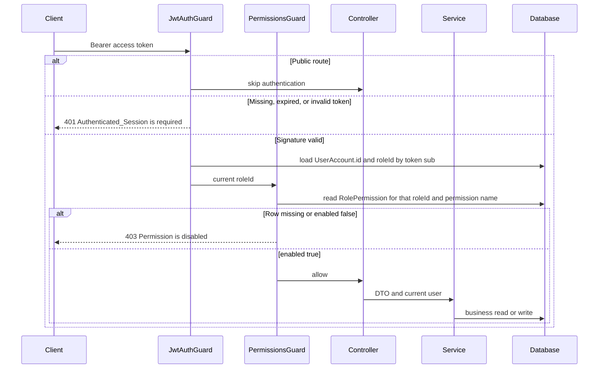
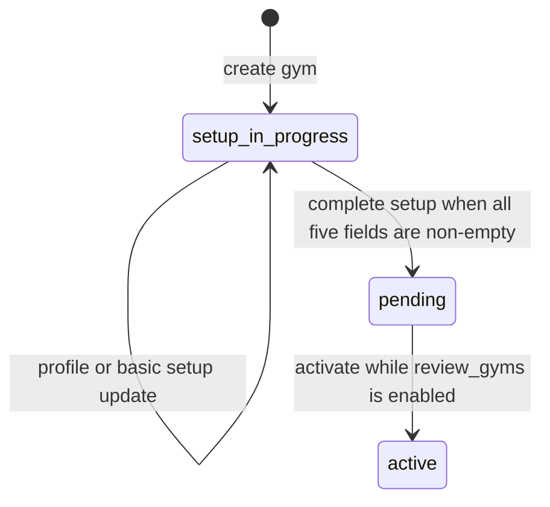

# Gym SaaS Foundation Design

## Overview

Phase 1 is a NestJS 12 ESM API (`package.json` `"type": "module"`, relative imports end in `.js`) that registers a gym owner, signs that owner or a super admin in, stores one owner profile and at most one gym, and lets a caller whose saved role has the matching permission finish setup, activate a pending gym, edit roles, assign roles, and read four platform counts.

The starter already wires `ConfigModule`, `DatabaseModule`, and empty modules for auth, users, roles, owner profiles, gyms, and dashboard, plus a public health check. This design fills those modules. It does not add a parallel `src/services` or `src/controllers` tree.

**Assumption (six tables):** The data model is exactly six tables: `UserAccount`, `Role`, `Permission`, `RolePermission`, `OwnerProfile`, and `Gym`. No seventh table is named by the requirements, so none is created. In particular there is no session table, refresh-token table, audit log, file object, `gym_profiles` table, or `user_roles` join. A user has one role through `UserAccount.roleId`. `Authenticated_Session` is a signed JWT access token, not a row. `Logo_Value` is a string column on `Gym`. `Platform_Stats` are four counts computed at read time, not stored rows.

Passwords are stored only as bcrypt hashes from the already installed `bcrypt` package (cost 12). The API does not add argon2. Access tokens are issued by the already installed `@nestjs/jwt`, `@nestjs/passport`, and `passport-jwt` packages. Permission checks read `RolePermission` on each protected request. They do not trust a permission claim from the token, and they do not hardcode the `Gym_Owner` permission set. The four permissions that must stay enabled on the role named `Super_Admin` are still stored as `RolePermission` rows.

Staff accounts, member accounts, binary logo upload, and any dashboard metric other than the four counts are out of scope.

## Architecture



`JwtAuthGuard` and `PermissionsGuard` are registered as global `APP_GUARD`s in `AppModule`, in that order. `app.module.ts` stays a composition root: it imports modules and registers the guards. It does not query Prisma or decide gym status.

A route is public only when it is marked `@Public()`. Registration, sign-in, and the existing `GET /` health handler are public. Every other handler declares `@RequirePermission(...)`. A handler that is neither public nor decorated is rejected with 403. The guard does not contain gym, profile, or role-edit rules. Those stay in the feature services.

The JWT payload is `{ "sub": "<user id>" }` only, signed HS256 with `JWT_SECRET`. It does not include email, role name, role id, or any permission. `JwtStrategy` verifies the signature and expiry, loads `UserAccount` by `sub`, and attaches `{ id, email, roleId }` from that row. If the id no longer exists, the strategy returns 401 and does not attach a user. Role assignment is visible on the next request because `roleId` is loaded from the user row, not from the token.

**Assumption (token lifetime):** Access tokens expire after one hour. There is no refresh token. An expired token is not an `Authenticated_Session` and gets the same 401 as a missing token. The client signs in again.



No other status transition exists. Profile update, basic setup update, and setup completion do not set `active`. Activation does not run for `setup_in_progress` or `active`. Nothing in Phase 1 moves `active` or `pending` backward.

PostgreSQL is the database, reached through `DATABASE_URL`. Prisma is the only data access path. Controllers do not import `PrismaClient`. `PrismaService` lives in `src/infrastructure/database/`, extends `PrismaClient` from `@prisma/client`, and connects on module init. `DatabaseModule` is global and provides it. If the installed Prisma CLI requires the URL in `prisma.config.ts` instead of `schema.prisma`, the URL moves there and the six models stay in `prisma/schema.prisma`. If this `@prisma/client` build cannot construct a client without a driver adapter, that adapter is created only inside `PrismaService`.

Startup seed runs once from `PlatformSeedService` (`OnApplicationBootstrap`) and is safe to run again:

1. Refuse to boot when `DATABASE_URL`, `JWT_SECRET`, `SUPER_ADMIN_EMAIL`, or `SUPER_ADMIN_PASSWORD` is missing, when the admin email fails the Phase 1 email predicate, or when the admin password length is outside 1 to 128. No default admin password is compiled into source.
2. Upsert the seven `Permission` rows by `name`.
3. Upsert `Role` rows named `Super_Admin` and `Gym_Owner`.
4. Insert any missing `RolePermission` row with the initial state below. Existing rows are left alone, so a later permission edit survives restart. `createMany` with `skipDuplicates` is the operation.
5. Insert the configured super admin `UserAccount` when no row has that `emailKey`. A unique violation from a concurrent boot is ignored. An existing row is not given a new password, role, or duplicate.

Initial `RolePermission.enabled` values:

| Permission | Super_Admin | Gym_Owner |
| --- | --- | --- |
| `view_dashboard` | enabled | disabled |
| `manage_users` | enabled | disabled |
| `manage_roles` | enabled | disabled |
| `review_gyms` | enabled | disabled |
| `create_gym` | disabled | enabled |
| `manage_owner_profile` | disabled | enabled |
| `manage_gym_setup` | disabled | enabled |

Those Gym_Owner states are seed data, not a list the guard consults. After seed, the guard's only input is the current `RolePermission` row.

## Components and Interfaces

Global pipe in `main.ts`: `ValidationPipe` with `whitelist: true`, `forbidNonWhitelisted: true`, and `transform: true`. DTOs constrain JSON types. Services own the Phase 1 predicates and the exact error text, because several rules (trim only four whitespace characters, ASCII-only case fold, "at least one non-whitespace character") are stricter or looser than `class-validator`'s stock decorators.

`PlatformExceptionFilter` returns `{ "statusCode": number, "message": string }` and does not return a stack, a Prisma error, a password, or a hash.

Shared email rules, used by registration, sign-in, role assignment, and seed, live in `src/common/validation/email-address.ts`:

- Trim only leading and trailing U+0020, tab, CR, and LF. Do not use `String.prototype.trim`, which removes other Unicode whitespace.
- After that trim, an email is valid when its length is 3 to 254 inclusive, it contains no U+0020, tab, CR, or LF, it contains exactly one `@`, and at least one character sits on each side of that `@`.
- `emailKey` replaces only ASCII `A`–`Z` with `a`–`z`. Every other character, including non-ASCII letters, stays as written. Lookup and the unique constraint use `emailKey`. The stored `email` is the trimmed value with its original case.
- Length limits use JavaScript `String.length` (UTF-16 code units). Spaces inside a password or a gym field are not stripped.

A password is accepted on registration when it is a string whose `length` is 1 to 128 inclusive. It is not trimmed.

Protected actions and the permission read for each:

| Action | Permission |
| --- | --- |
| `GET /dashboard` | `view_dashboard` |
| `GET /users`, `PUT /users/role` | `manage_users` |
| `GET /roles`, `POST /roles`, `PATCH /roles/permissions` | `manage_roles` |
| `GET /gyms/pending`, `POST /gyms/:id/activate` | `review_gyms` |
| `POST /gyms` | `create_gym` |
| `GET /owner-profile`, `PUT /owner-profile` | `manage_owner_profile` |
| `GET /gyms/me`, `PATCH /gyms/me/profile`, `PATCH /gyms/me/setup`, `POST /gyms/me/complete-setup` | `manage_gym_setup` |

The guard allows the action when that permission's row is enabled on the caller's current role. It does not also require the role name to be `Super_Admin` or `Gym_Owner`. Requirement 8 lets a super admin turn `review_gyms` on for another role, and Requirement 11 says a protected action is decided by the mapped permission's saved state. Default seed still leaves the admin-only permissions disabled on `Gym_Owner`.

`GET /gyms/me` and `GET /gyms/pending` are declared before `POST /gyms/:id/activate` so Nest does not treat `me` or `pending` as an id.

### Auth

`POST /auth/register` and `POST /auth/sign-in` are public. There is no second sign-in route. `POST /auth/sign-out` is also public. It clears the `shark.access-token` cookie and returns 204 with no body.

`RegisterDto` and `SignInDto` accept optional `email` and `password` strings. Any other property is rejected by the pipe.

`AuthService.register`:

1. Missing email, or empty after the Phase 1 trim, returns 400 `Email_Address is required` and writes nothing.
2. Otherwise invalid email returns 400 `Email_Address is not valid` and writes nothing.
3. Password missing, not a string, empty, or longer than 128 returns 400 `Password is not accepted` and writes nothing. This check runs only after the email is valid, so a bad email is reported first.
4. Load the `Gym_Owner` role by exact name.
5. `passwordHash = await bcrypt.hash(password, 12)`.
6. Insert `UserAccount` with the trimmed email, `emailKey`, that hash, and `roleId`. Do not insert `OwnerProfile` or `Gym`. Do not call `JwtService.sign`.
7. On unique violation of `email_key`, return 409 `Email_Address is already used` and do not change the existing user, hash, role, profile, or gym. Concurrent registrations of the same `emailKey` therefore create one row; PostgreSQL rejects the loser.
8. Respond 201 `{ "email": "<stored email>", "role": "Gym_Owner" }`. The body has no `password`, `passwordHash`, or `accessToken`.

`AuthService.signIn` uses the same trim, email predicate, and `emailKey`:

1. If the email is missing or not an email, or the password is missing or `length === 0`, return 400 `Sign-in input is invalid` and do not look up a user. A password of spaces is non-empty and is not this error. A password longer than 128 is still a candidate password on sign-in; registration's 128 limit is not re-applied as a distinct sign-in error.
2. Load the user by `emailKey`. Compare with `bcrypt.compare`. When no user exists, compare against a process-local dummy bcrypt hash of cost 12 so the two failure paths take the same comparison. If the user is missing or the comparison fails, return 401 `Email_Address and password do not match a User_Account`. That message is the only mismatch message. Write nothing and return no token.
3. When the email key matches and the password verifies, sign `{ sub: user.id }` and return 200 `{ "accessToken": "<jwt>" }`. The token contains no permissions. The same response sets an `HttpOnly`, `Secure`, `SameSite=Lax` cookie named `shark.access-token` with `Path=/` and `Max-Age` equal to the token lifetime (one hour). A disabled staff account returns 403 `Staff account is disabled` and does not set that cookie. Do not update email, hash, or role. Gym status does not matter, including when the user has no gym.

`GET /auth/me` accepts the `shark.access-token` cookie or `Authorization: Bearer`. When both are present, the bearer token is the session. `POST /auth/sign-out` clears `shark.access-token`.

bcrypt hashes only the first 72 bytes of input. Registration still accepts 1 to 128 characters, and sign-in verifies with `bcrypt.compare` on the submitted string. Property tests that need a hash to distinguish two passwords use passwords of at most 72 bytes. No pre-hash and no argon2 are added.

`AuthenticatedUser` becomes `{ id: string; email: string; roleId: string }`, loaded per request. `CurrentUser` keeps reading `request.user`.

### Owner profiles

`GET /owner-profile` and `PUT /owner-profile` require `manage_owner_profile`.

`PUT` body is `{ "displayName": string, "contact": string }`. Both are required. The service rejects, with 400 `Display name or contact value is empty or exceeds the maximum length`, when either value is omitted, is not a string, has length 0, has length above 100 for the display name or 254 for the contact, or contains no character outside U+0020, tab, CR, and LF. Rejection inserts nothing and does not change a stored row. The contact value does not have to be an email.

A valid put stores both strings exactly as submitted, with no trim, on the single `OwnerProfile` for `userId`. A second put replaces both columns. `userId` is unique.

`GET` returns `{ "displayName": "<stored>", "contact": "<stored>" }`. When no row exists it returns `{ "displayName": "", "contact": "" }` with 200 and does not insert.

### Gyms

`GymsService` looks up the caller's gym with `where: { ownerId: currentUser.id }`. Owner routes do not take another owner's id. A request to read or update a gym that is not linked to the caller, including a caller with no gym, returns 404 `Gym was not found` and writes nothing.

`POST /gyms` has an empty body and requires `create_gym`. It inserts one `Gym` with `ownerId` set, `status = setup_in_progress`, and `gymName`, `address`, `contact`, `timing`, and `logoValue` all null. It responds 201 with that gym. A second create for the same `ownerId`, whatever the current status, returns 409 `Gym already exists` and does not change the existing row. The unique `ownerId` constraint is what makes a concurrent double create return one row and one 409.

Gym JSON uses `null` for a field that has never been saved. The API does not return `""` for a missing gym field, and it does not persist `""`.

`PATCH /gyms/me/profile` body fields are any of `address`, `contact`, `logoValue`, `gymName`. `PATCH /gyms/me/setup` body fields are any of `timing`, `address`, `contact`, `gymName`. At least one of those fields must be present; otherwise 400 and no write. Each present value must be a string of length at least 1; otherwise 400 `Submitted gym value must contain at least one character` and no write. A whitespace-only gym value is valid. This is deliberate: owner-profile values must contain a non-whitespace character, and gym setup values must only be non-empty.

`address`, `contact`, and `gymName` are one column each. A profile patch and a setup patch write those same columns. A profile patch does not write `timing`. A setup patch does not write `logoValue`. Omitted fields are omitted from the Prisma `data` object.

Both patches run only while `status` is `setup_in_progress`. The update is `updateMany` with `where: { id, ownerId, status: setup_in_progress }`. When the status is already `pending` or `active`, the service returns 409 `Gym profile and basic setup cannot be changed while status is pending or active` and the row is unchanged. A lost race with setup completion hits the same `where` clause and changes nothing. Neither patch changes `status`.

`GET /gyms/me` returns `{ id, status, gymName, address, contact, timing, logoValue }`. `logoValue` is the last profile save. `timing` is the last setup save. `address`, `contact`, and `gymName` are whichever of those two routes saved them last.

`POST /gyms/me/complete-setup` requires all five of `gymName`, `address`, `contact`, `timing`, and `logoValue` to be stored, non-null, and length at least 1, and requires `status = setup_in_progress`. It then sets `status` to `pending` and does not change the five fields or `ownerId`. If any field is missing or empty, it returns 409 `Setup is incomplete` and writes nothing. The `Setup is incomplete` rejection applies only to the Gym whose `ownerId` is the session user. A Gym linked to another owner is not selected by this route and is left unchanged. If status is `pending` or `active`, it returns 409 `Setup completion is not allowed for this gym status` and writes nothing. If the owner has no gym, it returns 404. Completion never sets `active`.

`GET /gyms/pending` requires `review_gyms`. It returns gyms whose status is `pending` and no others, in unspecified order. Each item is `{ id, status, gymName, address, contact, timing, logoValue, ownerEmail }` where `ownerEmail` is the linked account's stored email. An empty pending set returns `{ "gyms": [] }`.

`POST /gyms/:id/activate` requires `review_gyms`. `:id` must be one stored gym id. The write is `updateMany` where `id` and `status = pending`, setting only `status` to `active`. Setup fields and `ownerId` are not in `data`. Other gyms are not updated. Zero rows updated is then classified: unknown id returns 404 `Activation requires one stored gym`; status `setup_in_progress` or `active` returns 409 `Only a pending gym can be activated`. A caller without `review_gyms` is stopped by the guard with 403 and the gym is unchanged. While a gym is `pending`, no other Phase 1 operation changes that status.

### Roles

`GET /roles` returns every role's `name` and the seven permission states. State values in JSON are the strings `"enabled"` and `"disabled"`, not booleans. The response includes `Super_Admin` and `Gym_Owner`. It does not include permission names outside the seven.

`POST /roles` body is `{ "name": string }`. The name must be 1 to 64 characters, must not start or end with U+0020, and must contain a character that is not U+0020. Comparison with existing names is exact, including case, on the `text` column (not `citext`), so `super_admin` is not `Super_Admin`. Failure returns 400 `Role name is not valid` for an empty, overlong, edge-space, or all-space name, and 409 `Role name is already used` for an exact collision. A valid create inserts the role and seven `RolePermission` rows, all `enabled = false`, and does not update older roles.

`PATCH /roles/permissions` body is `{ "roleName": string, "permission": string, "state": "enabled" | "disabled" }`. One call changes one permission. `roleName` must equal a stored role name character for character. `permission` must be one of the seven names. `state` must be one of those two strings. Any other shape returns 400 `Permission change is not valid` and writes nothing. An unknown role name returns 404 `Role was not found` and writes nothing.

The service updates the single `RolePermission` row for that pair. The other six rows on that role are not written. For the role whose name is exactly `Super_Admin`, a `state` of `"disabled"` for `view_dashboard`, `manage_users`, `manage_roles`, or `review_gyms` returns 400 `view_dashboard, manage_users, manage_roles, and review_gyms cannot be disabled on Super_Admin` and does not write. Those four rows stay `enabled = true`. Setting one of them to `"enabled"` is a successful no-op write of `true` and leaves the other six rows unchanged. `create_gym`, `manage_owner_profile`, and `manage_gym_setup` on `Super_Admin` can be set either way. No other role has a locked permission. The lock is this service check, not a missing row, and not a branch in the guard.

There is no role rename, role delete, or permission create endpoint.

### Users

`GET /users` returns `{ "users": [ { "email": string, "role": string } ] }` for every `UserAccount`, including every super admin and every gym owner. `role` is the current role name. The hash, `emailKey`, and password are not selected.

`PUT /users/role` body is `{ "email": string, "roleName": string }`. The email uses the same predicate and `emailKey` lookup as sign-in. `roleName` must match a stored role name character for character. On success the user's `roleId` is replaced, and email and `passwordHash` stay as they were. Other users stay as they were. A missing email, an email that is not valid, an unknown account, a missing role name, or an unknown role name returns 400 `Role assignment is not valid`, creates no user, creates no role, and updates nothing. The route is keyed by email because Requirement 9 identifies the account by `Email_Address`, not by a path id.

### Dashboard

`GET /dashboard` requires `view_dashboard`. `DashboardService` runs one Prisma transaction at isolation level `RepeatableRead` and returns exactly:

```json
{
  "userCount": 0,
  "setupInProgressCount": 0,
  "pendingCount": 0,
  "activeCount": 0
}
```

`userCount` is `UserAccount` count. The other three are `Gym` counts grouped by `status`. A status with no rows contributes `0`. The object has no further keys: no revenue, no attendance, and no user or gym list.

### Health

`GET /` stays the starter health response and is marked `@Public()`. It is not a Phase 1 protected action.

## Data Models

Schema file: `prisma/schema.prisma`. Table names are snake_case. Permission `name` is a unique `text` column, not a Postgres enum, so the seven names are rows the guard can read and a later name does not require an enum migration. `Gym.status` is a Postgres enum because the requirement allows only three values.

```prisma
generator client {
  provider = "prisma-client-js"
}

datasource db {
  provider = "postgresql"
  url      = env("DATABASE_URL")
}

enum GymStatus {
  setup_in_progress
  pending
  active

  @@map("gym_status")
}

model UserAccount {
  id           String        @id @default(uuid()) @db.Uuid
  email        String        @db.Text
  emailKey     String        @unique @map("email_key") @db.Text
  passwordHash String        @map("password_hash") @db.Text
  roleId       String        @map("role_id") @db.Uuid
  role         Role          @relation(fields: [roleId], references: [id], onDelete: Restrict)
  ownerProfile OwnerProfile?
  gym          Gym?

  @@map("user_accounts")
}

model Role {
  id          String           @id @default(uuid()) @db.Uuid
  name        String           @unique @db.Text
  users       UserAccount[]
  permissions RolePermission[]

  @@map("roles")
}

model Permission {
  id    String           @id @default(uuid()) @db.Uuid
  name  String           @unique @db.Text
  roles RolePermission[]

  @@map("permissions")
}

model RolePermission {
  roleId       String     @map("role_id") @db.Uuid
  permissionId String     @map("permission_id") @db.Uuid
  enabled      Boolean
  role         Role       @relation(fields: [roleId], references: [id], onDelete: Restrict)
  permission   Permission @relation(fields: [permissionId], references: [id], onDelete: Restrict)

  @@id([roleId, permissionId])
  @@map("role_permissions")
}

model OwnerProfile {
  id          String      @id @default(uuid()) @db.Uuid
  userId      String      @unique @map("user_id") @db.Uuid
  displayName String      @map("display_name") @db.Text
  contact     String      @db.Text
  user        UserAccount @relation(fields: [userId], references: [id], onDelete: Restrict)

  @@map("owner_profiles")
}

model Gym {
  id        String      @id @default(uuid()) @db.Uuid
  ownerId   String      @unique @map("owner_id") @db.Uuid
  status    GymStatus   @default(setup_in_progress)
  gymName   String?     @map("gym_name") @db.Text
  address   String?     @db.Text
  contact   String?     @db.Text
  timing    String?     @db.Text
  logoValue String?     @map("logo_value") @db.Text
  owner     UserAccount @relation(fields: [ownerId], references: [id], onDelete: Restrict)

  @@map("gyms")
}
```

`Gym.gymName` is the single `Gym_Name`. It is not a second table and not a second column for profile versus setup. `logo_value` is the submitted string, not a file id. No maximum length is specified for the five setup strings, so the columns are `text` and the service enforces only "at least one character" on write.

A migration adds `CHECK (email_key = ascii_email_key(email))`, where `ascii_email_key` is a SQL function that lowercases only ASCII `A`–`Z`. That keeps the stored case and the unique key from drifting if a write bypasses Prisma. It is not an extra table. `roles.name` stays plain `text` so uniqueness is case-sensitive. `password_hash` is never included in a response `select`.

Deleting users, roles, profiles, or gyms is not a Phase 1 operation. Foreign keys use `ON DELETE RESTRICT`.

## Correctness Properties

Properties are universally quantified statements. A single counterexample falsifies the property. Fast-check generates the inputs. Database properties run against PostgreSQL so unique constraints and committed permission rows are real.

### Property 1: Registration stores a bcrypt hash and no session

For any valid email and any password of length 1 to 128, registration persists a `passwordHash` for which `bcrypt.compare(password, hash)` is true and `hash` is not the password, the HTTP body contains neither the password nor the hash, and the response has no `accessToken` and does not create a stored session.

**Validates: Requirements 1.1, 1.2**

### Property 2: Case-insensitive email uniqueness under concurrency

For any pair of valid registration inputs whose trimmed emails differ only by ASCII letter case, at most one `UserAccount` exists for that `emailKey`. When those registrations run concurrently and no row exists yet, exactly one account is created, every other response is `Email_Address is already used`, and the loser's attempt does not change the winner's email, hash, role, or gym. The stored email case is the trimmed case from the winning submission.

**Validates: Requirements 1.5, 1.7**

### Property 3: Sign-in JWT and one mismatch error

For any stored account, sign-in with an `emailKey` match and a non-empty password that `bcrypt.compare` accepts returns a JWT whose `sub` is that user id and leaves email, hash, and role unchanged, with or without a gym and for every gym status. For any valid email shape and non-empty password, an unknown `emailKey` and a known `emailKey` with a failing compare return the same status code and the same message, return no token, and leave every user unchanged.

**Validates: Requirements 2.1, 2.3**

### Property 4: One gym per owner

For any caller whose current role has `create_gym` enabled and who has no gym, the first create inserts one `Gym` with that `ownerId`, status `setup_in_progress`, and all five setup fields null. A second create for that same `ownerId` is rejected for every current status. The `ownerId` unique constraint keeps the row count at one, including when two creates are in flight.

**Validates: Requirements 4.1, 4.2**

### Property 5: Shared gym columns and unchanged setup status

For any gym in `setup_in_progress` and any non-empty address, contact, and gym name, a profile update and a basic setup update write those three values to the same `address`, `contact`, and `gym_name` columns. A profile update does not change `timing`. A setup update does not change `logo_value`. Fields omitted from the body stay as they were. Both updates leave status `setup_in_progress`.

**Validates: Requirements 5.1, 5.2, 6.6**

### Property 6: No profile or setup writes after submission

For any gym whose status is `pending` or `active`, both a gym profile update and a basic setup update are rejected, and status, the five setup fields, and `ownerId` stay byte-for-byte as they were.

**Validates: Requirements 5.8**

### Property 7: Pending only from complete setup, active only from review

For any gym, setup completion sets status to `pending` only when status is `setup_in_progress` and `gymName`, `address`, `contact`, `timing`, and `logoValue` are each non-empty, and that write does not change those fields or `ownerId`. Otherwise the row is unchanged. The only write that sets `pending` to `active` is activation performed while `RolePermission` for `review_gyms` is enabled on the caller's current role, and that write changes only status. While status remains `pending`, every other Phase 1 operation leaves it `pending`.

**Validates: Requirements 6.1, 7.2, 7.6**

### Property 8: Permission reads use RolePermission after the token is issued

For any role, any of the seven permissions, and any JWT whose `sub` was signed before a change to that permission, the next protected request mapped to that permission is rejected when the committed `RolePermission.enabled` is false and is not rejected for a disabled permission when the committed value is true. The decision matches the row read on that request, not a claim inside the token. The token remains usable afterward.

**Validates: Requirements 11.2, 11.3**

### Property 9: Super_Admin cannot drop the four locked permissions

For any of `view_dashboard`, `manage_users`, `manage_roles`, and `review_gyms`, setting that permission to disabled on the role named `Super_Admin` is rejected, that row stays enabled, and the other six `RolePermission` rows on that role stay as they were.

**Validates: Requirements 8.9**

### Property 10: Dashboard is four stored counts

For any set of stored users and gyms, `GET /dashboard` returns `userCount`, `setupInProgressCount`, `pendingCount`, and `activeCount` equal to the number of `UserAccount` rows and the number of `Gym` rows in each status, using 0 when a status is absent. The JSON object has no other keys and no embedded list.

**Validates: Requirements 10.1, 10.2**

## Error Handling

| Condition | Status | Message |
| --- | --- | --- |
| Register with no usable email | 400 | `Email_Address is required` |
| Register with a malformed email | 400 | `Email_Address is not valid` |
| Register with an unacceptable password | 400 | `Password is not accepted` |
| Register with an `emailKey` that exists | 409 | `Email_Address is already used` |
| Sign-in input missing or not an email, or password empty | 400 | `Sign-in input is invalid` |
| Unknown email or wrong password | 401 | `Email_Address and password do not match a User_Account` |
| Missing, expired, or invalid token, or unknown `sub` | 401 | `Authenticated_Session is required` |
| Mapped `RolePermission` missing or disabled | 403 | `Permission is disabled` |
| Owner profile empty, whitespace-only, or over the max length | 400 | `Display name or contact value is empty or exceeds the maximum length` |
| Owner gym missing, or gym id not stored | 404 | `Gym was not found` |
| Second gym for the same owner | 409 | `Gym already exists` |
| Empty gym field, or profile/setup body with none of its fields | 400 | `Submitted gym value must contain at least one character` |
| Profile or setup update while `pending` or `active` | 409 | `Gym profile and basic setup cannot be changed while status is pending or active` |
| Complete setup with a missing or empty field | 409 | `Setup is incomplete` |
| Complete setup while not `setup_in_progress` | 409 | `Setup completion is not allowed for this gym status` |
| Activate without a stored gym id | 404 | `Activation requires one stored gym` |
| Activate a gym that is not `pending` | 409 | `Only a pending gym can be activated` |
| Invalid new role name | 400 | `Role name is not valid` |
| Role name already stored with the same case | 409 | `Role name is already used` |
| Permission name or state not in the allowed set | 400 | `Permission change is not valid` |
| Disable a locked permission on `Super_Admin` | 400 | `view_dashboard, manage_users, manage_roles, and review_gyms cannot be disabled on Super_Admin` |
| Permission patch for an unknown role name | 404 | `Role was not found` |
| Role assignment email or role name cannot be applied | 400 | `Role assignment is not valid` |

Unknown-email sign-in and wrong-password sign-in share one code path and one message. The service does not branch the response text on which check failed.

Prisma unique violations are caught at the insert that the unique index protects (`email_key`, `gyms.owner_id`, `roles.name`) and mapped to the 409 row above. Other database failures stay 500 with a fixed message and no schema details. The filter does not echo `password`, `passwordHash`, the bearer token, or `JWT_SECRET`. Logs for a rejected request may include the route, status code, and error class only.

Validation-pipe failures for non-string JSON or unknown properties are 400. They happen before a service write.

## Testing Strategy

Vitest is the runner already configured in `vitest.config.ts` (`**/*.spec.ts`) and `vitest.config.e2e.ts` (`**/*.e2e-spec.ts`). Supertest is already installed. `fast-check` is added as a dev dependency and is not used in production code.

Unit tests, under `pnpm test`, cover pure functions and service branches with a mocked `PrismaService`:

- Email trim, `emailKey` (ASCII `A`–`Z` only), and the email predicate, including internal spaces and a non-ASCII letter that must not be folded.
- Password length boundaries 0, 1, 128, and 129, with spaces counted.
- Owner-profile whitespace versus gym-field whitespace.
- `RolesService` rejection of a locked disable, and a one-row update that leaves the other six states untouched.
- `DashboardService` mapping a `groupBy` result that omits a status onto `0`, and `Object.keys` of the response equal to the four count names.
- Registration response builder never copies `password` or `passwordHash`, and the register method does not call `JwtService.sign`.

Property tests import `fc` from `fast-check`. Each property in this document has one test whose name starts with `Feature: gym-saas-foundation, Property N:`. Arbitraries draw emails from the Phase 1 predicate, passwords of length 1 to 72 bytes for hash round-trips, gym strings of length at least 1, and permission names from the seven constants in `src/common/constants/permissions.ts`. Each test runs at least 100 examples, except the two concurrency properties, which run 20 committed examples.

Properties 2, 4, 7, 8, and 10 are `*.e2e-spec.ts` cases against PostgreSQL (`TEST_DATABASE_URL`) through the Nest app and supertest, so the assertions observe HTTP status, response JSON, and committed rows. `beforeEach` migrates, truncates the six tables, and runs `PlatformSeedService` again. Property 2 fires two `POST /auth/register` calls with `Promise.all`. Property 4 does the same with `POST /gyms`. Property 8 signs in, patches a permission, then calls the mapped route with the original bearer token. Property 3 includes a forged token that adds a permission claim and still expects the guard to follow the database row.

Example tests, not properties, cover the remaining acceptance messages: invalid registration email, empty sign-in password, `GET /owner-profile` before any put (empty strings and zero `OwnerProfile` rows), setup completion with one field still null, activation of a non-pending gym, role-name case collision, and a dashboard body that does not contain revenue or attendance keys. The health route stays reachable without a token.
