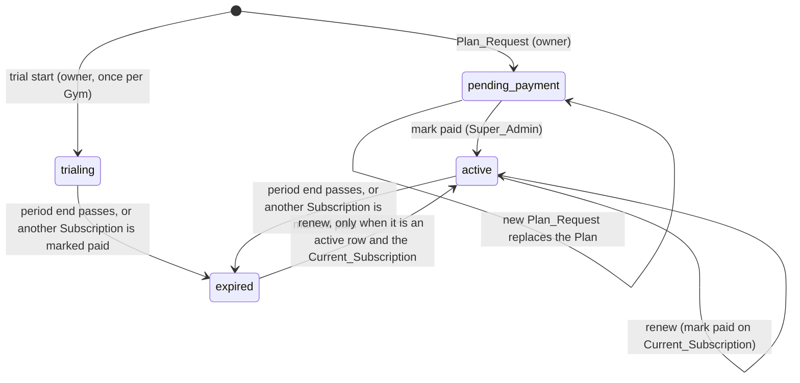
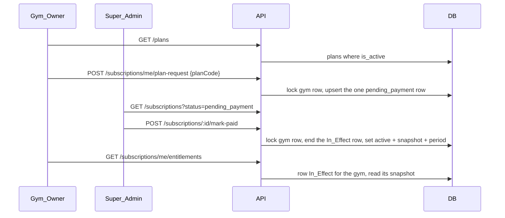

# Plan and Subscription Engine Design

## Overview

Phase 2 adds two NestJS modules to the existing ESM API (`"type": "module"`, relative imports end in `.js`): `src/modules/plans/` for the Plan catalog and `src/modules/subscriptions/` for trials, Plan_Requests, manual payment, renewal, and Entitlements. It also adds four Permissions, two Prisma models, and one new migration. Phase 1 modules keep their routes and error messages.

The design follows the decisions in `requirements.md`:

- No payment provider. A Super_Admin calls one "mark paid" route, which either activates a Plan_Request or renews the Current_Subscription.
- A Subscription belongs to a Gym. Owner actions first load the caller's Gym through the existing `GymsService.getMine`, which already returns 404 `Gym was not found`, and then require `status === 'active'`. Phase 2 never writes the `gyms` table.
- Prices are whole paise in INR. Limits are three nullable integers, where `null` means unlimited. Feature_Flags are a `text[]` of snake_case keys.
- A Subscription stores a Plan_Snapshot when it starts and when it is renewed. Plan edits never touch `subscriptions` rows.
- Expiry is computed on read. The stored states are `trialing`, `pending_payment`, and `active`. `expired` is only ever reported.
- No scheduled job, no queue, no new package.

**Decision (seeded placeholders, accepted 2026-11-22):** `basic`, `pro`, and `enterprise` are seeded inactive with price 0, trial 0, no flags, and every limit 0. A Super_Admin sets the real values with `PATCH /plans/:code` and activates each one. Source code holds no price. The other accepted decisions (calendar-month billing, no credit on a plan switch, no trial-to-paid conversion, renewable deactivated Plans, and database-enforced trial and request limits) are listed in `requirements.md`.

## Architecture

```text
src/
  common/constants/
    permissions.ts            (+4 names)
    plan-currency.ts          (new: PLAN_CURRENCY = 'INR')
    subscription-status.ts    (new: the four reported statuses)
  common/filters/
    platform-exception.filter.ts  (collapse repeated validation messages)
  infrastructure/database/
    platform-seed.service.ts  (+defaults for the 4 names, backfill every Role)
  modules/
    roles/roles.service.ts    (+lock manage_plans and manage_subscriptions)
    plans/
      dto/create-plan.dto.ts, dto/update-plan.dto.ts, dto/index.ts
      plan-values.ts          (pure validation and mapping)
      plan-seed.service.ts    (OnApplicationBootstrap, seeds the 3 placeholders)
      plans.controller.ts, plans.service.ts, plans.module.ts
    subscriptions/
      dto/select-plan.dto.ts, dto/list-subscriptions-query.dto.ts, dto/index.ts
      billing-period.ts       (pure date arithmetic)
      subscription-state.ts   (pure status, In_Effect, Current_Subscription)
      subscriptions.controller.ts, subscriptions.service.ts, subscriptions.module.ts
```

`AppModule` imports `PlansModule` and `SubscriptionsModule` and stays a composition root. `SubscriptionsModule` imports `GymsModule`, which already exports `GymsService`. `SubscriptionsService` reads `plans` rows through Prisma inside its own transactions, so the Plan_Snapshot is read under the same lock as the write. Plan validation and Plan writes stay in `PlansService`.

The global `JwtAuthGuard` and `PermissionsGuard` are unchanged. Every new handler declares `@RequirePermission(...)` with one of the four new names, so the Phase 1 401 and 403 behavior applies to all of them.



`expired` in the diagram is a reported status. The row keeps its stored state (`trialing` or `active`) and its `current_period_end` is in the past.



### Concurrency

Every Subscription write runs in one interactive `prisma.$transaction` that first locks the Gym row:

```ts
await tx.$queryRaw`SELECT "id" FROM "gyms" WHERE "id" = ${gymId}::uuid FOR UPDATE`;
```

The tagged template sends `gymId` as a bind parameter. Under the default `READ COMMITTED` isolation, each statement after the lock sees rows committed by the previous holder, so the checks for "trial used", "In_Effect", and "existing Plan_Request" are not racy. The lock does not change the Gym row.

The database also enforces the two per-Gym invariants with partial unique indexes, so a write that skips the service still cannot break them:

- one `pending_payment` row per `gym_id`
- one `trialing` row per `gym_id`, and a trial row keeps the `trialing` state forever, so this means one trial ever

A unique violation on the trial index maps to 409 `Trial already used`. "At most one In_Effect row" depends on the current time, so the database cannot express it as a constraint. The gym lock plus the mark-paid step that ends the previous row keep it true.

**Fallback (accepted 2026-11-22):** The partial indexes are declared in the Prisma schema through the `partialIndexes` preview feature. If that feature causes an implementation issue (validation, client generation, migration drift, or a runtime error), remove the preview flag and the two `@@unique(..., where: ...)` lines from the schema, and keep the same two `CREATE UNIQUE INDEX ... WHERE` statements as raw SQL in the Phase 2 migration. The index names, the error mapping, and the gym lock stay the same.

## Components and Interfaces

### Permissions and roles

`PERMISSIONS` in `src/common/constants/permissions.ts` gains four names, appended in this order: `view_plans`, `manage_plans`, `manage_subscriptions`, `manage_gym_subscription`. The `Permission` type, `@RequirePermission`, the roles DTO check, `GET /roles`, and `GET /auth/me` all derive from that array, so they pick up the new names without further edits.

`PlatformSeedService` changes:

- `SUPER_ADMIN_ENABLED` adds `manage_plans` and `manage_subscriptions`.
- `GYM_OWNER_ENABLED` adds `view_plans` and `manage_gym_subscription`.
- The `RolePermission` backfill loads every Role, not only the two built-in ones. `enabledFor` already returns `false` for any other role name. The write stays `createMany` with `skipDuplicates`, so existing rows, including every saved Phase 1 state, are not touched. This is what gives a Phase 1 database the four new rows on first boot and keeps `PATCH /roles/permissions` from hitting a missing row on an older custom Role.

| Permission | Super_Admin | Gym_Owner | Other Roles |
| --- | --- | --- | --- |
| `view_plans` | disabled | enabled | disabled |
| `manage_plans` | enabled, locked | disabled | disabled |
| `manage_subscriptions` | enabled, locked | disabled | disabled |
| `manage_gym_subscription` | disabled | enabled | disabled |

`RolesService.setPermission` keeps the Phase 1 check and message for the four Phase 1 locked names. It adds a second check, run after the first, for the role named exactly `Super_Admin`: `state === 'disabled'` on `manage_plans` or `manage_subscriptions` returns 400 `manage_plans and manage_subscriptions cannot be disabled on Super_Admin` and writes nothing. The Phase 1 message text does not change.

Protected actions:

| Route | Permission | Success |
| --- | --- | --- |
| `GET /plans` | `view_plans` | 200 |
| `GET /plans/all` | `manage_plans` | 200 |
| `POST /plans` | `manage_plans` | 201 |
| `PATCH /plans/:code` | `manage_plans` | 200 |
| `GET /subscriptions` | `manage_subscriptions` | 200 |
| `POST /subscriptions/:id/mark-paid` | `manage_subscriptions` | 200 |
| `GET /subscriptions/me` | `manage_gym_subscription` | 200 |
| `GET /subscriptions/me/entitlements` | `manage_gym_subscription` | 200 |
| `POST /subscriptions/me/trial` | `manage_gym_subscription` | 201 |
| `POST /subscriptions/me/plan-request` | `manage_gym_subscription` | 201 |

`GET /plans/all` is declared before any `:code` handler. The `me` handlers are declared before `:id/mark-paid`.

### Validation messages

DTO decorators carry the Phase 2 message, for example `@IsInt({ message: 'Plan values are not valid' })`, so a wrong JSON type and a wrong range return the same text. When several properties fail, `ValidationPipe` returns an array with the same string several times. `PlatformExceptionFilter.messageFromHttpException` collapses repeated strings before joining (`[...new Set(messages)].join(', ')`). Phase 1 DTOs use class-validator's default messages, which name the property and are never identical, so no Phase 1 response changes. Unknown properties are still rejected by `forbidNonWhitelisted` with the pipe's own message.

### Plans

`plan-values.ts` holds the rules as pure functions, so they are testable without Nest:

- `code`: string matching `^[a-z][a-z0-9_]{0,31}$`.
- `name`: string, `length` 1 to 64, containing at least one character other than U+0020, tab, CR, and LF. Stored exactly as submitted.
- `priceMonthlyPaise`: `Number.isInteger`, 0 to 2,147,483,647.
- `trialDays`: `Number.isInteger`, 0 to 365.
- `featureFlags`: array of 0 to 50 strings, each matching `^[a-z][a-z0-9_]{0,63}$`, with no duplicates. Stored in submitted order.
- `maxMembers`, `maxStaff`, `maxBranches`: `null` (unlimited) or `Number.isInteger` 0 to 2,147,483,647.
- `isActive`: boolean.

`undefined` means "not submitted", the same convention Phase 1 uses for gym fields. JSON cannot carry `undefined`, so `null` is always a submitted value. `null` is valid only for the three limits.

`parseCreatePlan(body)` requires every field except `isActive`, which defaults to `true`. `parseUpdatePlan(body)` requires at least one of `name`, `priceMonthlyPaise`, `trialDays`, `featureFlags`, `maxMembers`, `maxStaff`, `maxBranches`, `isActive`, and returns only the submitted fields. Both throw 400 `Plan values are not valid`. `CreatePlanDto` and `UpdatePlanDto` mark every field `@IsOptional()` with a type decorator carrying that message. `UpdatePlanDto` has no `code` property, so a body containing `code` is rejected by the pipe before the service runs.

`PlanResponse`:

```json
{
  "code": "pro",
  "name": "Pro",
  "priceMonthlyPaise": 149900,
  "currency": "INR",
  "trialDays": 14,
  "featureFlags": ["attendance"],
  "maxMembers": 500,
  "maxStaff": 10,
  "maxBranches": null,
  "isActive": true
}
```

`currency` comes from `PLAN_CURRENCY` and is not stored. The example values are illustrative only.

`PlansService`:

- `listAvailable()`: `where: { isActive: true }`. `listAll()`: no filter. Both sort in the service by `priceMonthlyPaise` ascending and then by `code` in byte order, and return `{ "plans": PlanResponse[] }`. Sorting in SQL would make the `code` tie-break depend on the database collation, which can ignore `_`.
- `create(body)`: insert. A unique violation on `plans.code` returns 409 `Plan code is already used`. Concurrent creates of one code therefore produce one row.
- `update(code, body)`: `updateMany({ where: { code }, data })`. Count 0 returns 404 `Plan was not found`. Then read and return the row. No `subscriptions` row is written.
- `seedDefaultPlans()`: `createMany({ data: [basic, pro, enterprise], skipDuplicates: true })` with names `Basic`, `Pro`, `Enterprise`, price 0, trial 0, `featureFlags: []`, every limit 0, `isActive: false`. Existing rows are left alone, so Super_Admin edits survive a restart, and concurrent boots insert each code once.

`PlanSeedService` implements `OnApplicationBootstrap` and calls `seedDefaultPlans()`. It is provided and exported by `PlansModule` so the e2e helper can call it after truncating.

There is no delete route.

### Subscription time rules

`billing-period.ts`:

- `addOneMonthUtc(from)`: same UTC time of day, next calendar month (December rolls to January of the next year), day of month `min(from day, last day of the target month)`. Examples: `2026-01-31T10:00Z` becomes `2026-02-28T10:00Z`, `2028-01-31T10:00Z` becomes `2028-02-29T10:00Z`, and `2026-12-15T00:00Z` becomes `2027-01-15T00:00Z`. Renewing from a clamped end keeps the clamped day (Feb 28 renews to Mar 28). That drift is accepted.
- `addTrialDays(from, days)`: `from + days × 86,400,000 ms`.

`subscription-state.ts`, all taking `now: Date` explicitly:

- `isInEffect(row, now)`: stored state `trialing` or `active` and `currentPeriodEnd > now`.
- `reportedStatus(row, now)`: `pending_payment` for that state. Otherwise the stored state while In_Effect, and `expired` when it is not.
- `pickCurrent(rows)`: among `trialing` and `active` rows, the one with the latest `currentPeriodEnd`. Ties cannot happen through the API, because every new or renewed row ends after `now` and every other row ended at or before `now`. The helper still breaks ties by later `createdAt`, then by `id`.
- `whereReportedStatus(status, now)`: the Prisma filter for each reported status, for example `expired` is `{ status: { in: ['trialing', 'active'] }, currentPeriodEnd: { lte: now } }`.
- `entitlementsFrom(rows, now)`: picks the row In_Effect, if any, and maps it to the Entitlements shape below, or returns the empty shape.

Each service method reads `new Date()` once and passes it to these helpers.

### Subscriptions

`SubscriptionResponse`:

```json
{
  "id": "6f1c…",
  "status": "active",
  "planCode": "pro",
  "planName": "Pro",
  "priceMonthlyPaise": 149900,
  "currency": "INR",
  "featureFlags": ["attendance"],
  "maxMembers": 500,
  "maxStaff": 10,
  "maxBranches": null,
  "currentPeriodStart": "2026-11-22T10:00:00.000Z",
  "currentPeriodEnd": "2026-12-22T10:00:00.000Z",
  "createdAt": "2026-11-20T09:00:00.000Z",
  "isTrial": false
}
```

`isTrial` is `status === 'trialing'` on the stored row (Requirement 10.7). It stays `true` after a trial expires, while `status` then reports `expired`. It is `false` for a Plan_Request and for an `active` row. Clients use it to hide Renew on expired trials, which mark-paid would reject with 409 `A trial cannot be marked paid`.

For `trialing` and `active` rows, the name, price, flags, and limits come from the row's Plan_Snapshot. For a Plan_Request, they come from the joined Plan's current values and both period fields are `null`. `planCode` always comes from the joined Plan, because a code cannot change. The admin list item adds `gymId`, `gymName`, and `ownerEmail`.

`SubscriptionsService` depends on `PrismaService` and `GymsService`.

`getMine(ownerId)`, `GET /subscriptions/me`:

1. `gym = await gymsService.getMine(ownerId)`, which throws the Phase 1 404.
2. Load every row for `gym.id` with its Plan.
3. Return `{ "current": SubscriptionResponse | null, "pending": SubscriptionResponse | null, "trialUsed": boolean }`, where `current = pickCurrent(rows)`, `pending` is the `pending_payment` row, and `trialUsed` is true when a `trialing` row exists. A Gym that is not `active` has no rows, so it returns nulls and `false`.

`getEntitlements(ownerId)`, `GET /subscriptions/me/entitlements`: load the Gym as above, then return `entitlementsForGym(gym.id)`.

`entitlementsForGym(gymId, now = new Date())` is exported for later modules. It loads the Gym's `trialing` and `active` rows with their Plan and returns `entitlementsFrom(rows, now)`:

```json
{
  "plan": { "code": "pro", "name": "Pro" },
  "status": "active",
  "featureFlags": ["attendance"],
  "maxMembers": 500,
  "maxStaff": 10,
  "maxBranches": null,
  "currentPeriodEnd": "2026-12-22T10:00:00.000Z"
}
```

With no row In_Effect, it returns `{ "plan": null, "status": null, "featureFlags": [], "maxMembers": 0, "maxStaff": 0, "maxBranches": 0, "currentPeriodEnd": null }`. In the first shape a `null` limit means unlimited. In the empty shape every limit is `0`. No Phase 1 or Phase 2 handler calls this method to allow or deny anything.

`startTrial(ownerId, planCode)`, `POST /subscriptions/me/trial`, body `{ "planCode": string }`:

1. `planCode` missing or `""` returns 400 `Plan selection is not valid`. A non-string is rejected by `SelectPlanDto` with the same message.
2. Load the Gym (404 `Gym was not found`). A status other than `active` returns 409 `Plan selection requires an active gym`.
3. In a transaction, lock the Gym row, then:
   1. `plan = tx.plan.findFirst({ where: { code: planCode, isActive: true } })`. None returns 404 `Plan was not found`.
   2. `plan.trialDays === 0` returns 409 `This plan has no trial`.
   3. A `trialing` row for this Gym returns 409 `Trial already used`.
   4. A row In_Effect returns 409 `A subscription is already in effect`.
   5. Insert `{ gymId, planId, status: 'trialing', ...snapshot(plan), currentPeriodStart: now, currentPeriodEnd: addTrialDays(now, plan.trialDays) }`.
4. A unique violation on `subscriptions_one_trial_per_gym` returns 409 `Trial already used`.
5. Respond 201 with the `SubscriptionResponse`. Any Plan_Request stays as it was.

`requestPlan(ownerId, planCode)`, `POST /subscriptions/me/plan-request`, body `{ "planCode": string }`:

1. Steps 1 and 2 of `startTrial`.
2. In a transaction, lock the Gym row, then:
   1. Find the Available_Plan (404 `Plan was not found`).
   2. When the row In_Effect has stored state `active` and `planId === plan.id`, return 409 `This plan is already in effect`. A `trialing` row on the same Plan does not block the request.
   3. When a `pending_payment` row exists, set its `planId` to `plan.id` if it differs. Otherwise insert `{ gymId, planId, status: 'pending_payment' }` with no snapshot and no period.
3. Respond 201 with the Plan_Request as a `SubscriptionResponse`. The row In_Effect is not written.

`markPaid(id)`, `POST /subscriptions/:id/mark-paid`, empty body:

1. An `id` that is not a UUID, or that matches no row, returns 404 `Subscription was not found`. Check the format with `isUUID` from the installed `class-validator` before querying, so a malformed id never reaches Postgres as a cast error.
2. In a transaction, lock the row's Gym, read the row again, and set `now`:
   - `trialing`: 409 `A trial cannot be marked paid`.
   - `pending_payment`: read its Plan by `planId`, ignoring `isActive`. `updateMany` the other rows of this Gym where the state is `trialing` or `active` and `currentPeriodEnd > now`, setting `currentPeriodEnd = now`. Then update this row to `active` with `snapshot(plan)`, `currentPeriodStart = now`, and `currentPeriodEnd = addOneMonthUtc(now)`.
   - `active`: load this Gym's `trialing` and `active` rows. If `pickCurrent(rows).id !== id`, return 409 `Only the current subscription can be renewed`. Otherwise read the Plan, ignoring `isActive`, and write `snapshot(plan)`. If the row is In_Effect, set `currentPeriodEnd = addOneMonthUtc(currentPeriodEnd)` and keep the start. If it is not, set `currentPeriodStart = now` and `currentPeriodEnd = addOneMonthUtc(now)`.
3. Respond 200 with the admin list item for that row. No other Gym's rows, and no `gyms`, `user_accounts`, or `owner_profiles` row, are written.

`snapshot(plan)` copies `name` to `planName`, plus `priceMonthlyPaise`, `featureFlags`, `maxMembers`, `maxStaff`, and `maxBranches`.

`list(status?)`, `GET /subscriptions?status=…`: `ListSubscriptionsQueryDto` accepts an optional `status` validated with `@IsIn(SUBSCRIPTION_STATUSES, { message: 'Subscription filter is not valid' })`. The service builds `where` from `whereReportedStatus(status, now)` when a filter is given, includes the Plan and `gym { gymName, owner { email } }`, orders by `createdAt` then `id` ascending, and returns `{ "subscriptions": AdminSubscriptionResponse[] }`. It never selects `passwordHash`.

## Data Models

`prisma/schema.prisma` changes. The existing six models keep their columns. `Gym` gains only the relation field.

```prisma
generator client {
  provider        = "prisma-client-js"
  previewFeatures = ["partialIndexes"]
}

enum SubscriptionStatus {
  trialing
  pending_payment
  active

  @@map("subscription_status")
}

model Gym {
  // existing fields unchanged
  subscriptions Subscription[]
}

model Plan {
  id                String         @id @default(uuid()) @db.Uuid
  code              String         @unique @db.Text
  name              String         @db.Text
  priceMonthlyPaise Int            @map("price_monthly_paise")
  trialDays         Int            @map("trial_days")
  featureFlags      String[]       @default([]) @map("feature_flags")
  maxMembers        Int?           @map("max_members")
  maxStaff          Int?           @map("max_staff")
  maxBranches       Int?           @map("max_branches")
  isActive          Boolean        @default(true) @map("is_active")
  createdAt         DateTime       @default(now()) @map("created_at") @db.Timestamptz(3)
  subscriptions     Subscription[]

  @@map("plans")
}

model Subscription {
  id                 String             @id @default(uuid()) @db.Uuid
  gymId              String             @map("gym_id") @db.Uuid
  planId             String             @map("plan_id") @db.Uuid
  status             SubscriptionStatus
  planName           String?            @map("plan_name") @db.Text
  priceMonthlyPaise  Int?               @map("price_monthly_paise")
  featureFlags       String[]           @default([]) @map("feature_flags")
  maxMembers         Int?               @map("max_members")
  maxStaff           Int?               @map("max_staff")
  maxBranches        Int?               @map("max_branches")
  currentPeriodStart DateTime?          @map("current_period_start") @db.Timestamptz(3)
  currentPeriodEnd   DateTime?          @map("current_period_end") @db.Timestamptz(3)
  createdAt          DateTime           @default(now()) @map("created_at") @db.Timestamptz(3)
  gym                Gym                @relation(fields: [gymId], references: [id], onDelete: Restrict)
  plan               Plan               @relation(fields: [planId], references: [id], onDelete: Restrict)

  @@unique([gymId], map: "subscriptions_one_pending_per_gym", where: { status: "pending_payment" })
  @@unique([gymId], map: "subscriptions_one_trial_per_gym", where: { status: "trialing" })
  @@index([gymId])
  @@map("subscriptions")
}
```

The installed Prisma 7.10.1 validates this schema, generates a client from it, and emits `CREATE UNIQUE INDEX … WHERE ("status" = 'pending_payment')` for the partial indexes. All three were checked against a scratch copy while writing this design.

`Plan.isActive` is a boolean, not an enum, because the requirement has only two states. Prices are `integer`, which holds up to 2,147,483,647 paise. Postgres creates Prisma scalar lists as nullable `text[]`, so the migration's CHECK constraints add the NOT NULL rule.

The migration is new: `prisma/migrations/20261122120000_plan_subscription_engine/migration.sql`. The applied `20260319120000_init` migration is not edited. Generate the DDL with `prisma migrate diff --from-schema <copy of the Phase 1 schema> --to-schema prisma/schema.prisma --script`, then append the constraints, which Prisma does not model, the same way Phase 1 added the email CHECK:

```sql
ALTER TABLE "plans" ADD CONSTRAINT "plans_values_check" CHECK (
  "code" ~ '^[a-z][a-z0-9_]{0,31}$'
  AND char_length("name") BETWEEN 1 AND 64
  AND "price_monthly_paise" >= 0
  AND "trial_days" BETWEEN 0 AND 365
  AND "feature_flags" IS NOT NULL
  AND cardinality("feature_flags") <= 50
  AND ("max_members" IS NULL OR "max_members" >= 0)
  AND ("max_staff" IS NULL OR "max_staff" >= 0)
  AND ("max_branches" IS NULL OR "max_branches" >= 0)
);

ALTER TABLE "subscriptions" ADD CONSTRAINT "subscriptions_state_check" CHECK (
  "feature_flags" IS NOT NULL
  AND (
    (
      "status" = 'pending_payment'
      AND "current_period_start" IS NULL
      AND "current_period_end" IS NULL
      AND "plan_name" IS NULL
      AND "price_monthly_paise" IS NULL
    )
    OR (
      "status" <> 'pending_payment'
      AND "current_period_start" IS NOT NULL
      AND "current_period_end" IS NOT NULL
      AND "current_period_end" >= "current_period_start"
      AND "plan_name" IS NOT NULL
      AND "price_monthly_paise" IS NOT NULL
    )
  )
);
```

The migration adds tables and does not change or reinterpret any Phase 1 row. Permission rows and the seeded Plans come from the startup seeds, not from SQL, so a restart stays idempotent.

## Correctness Properties

Properties are universally quantified, so one counterexample falsifies a property. Fast-check generates the inputs. Each test name starts with `Feature: plan-subscription-engine, Property N:`.

### Property 1: Permission defaults and backfill

For any set of custom Roles and any saved states of the seven Phase 1 Permissions on any Role, starting from a database where the four Phase 2 Permission rows and their `RolePermission` rows are absent, running the seed gives Super_Admin `manage_plans` and `manage_subscriptions` enabled and `view_plans` and `manage_gym_subscription` disabled, gives Gym_Owner the reverse, gives every other Role all four disabled, and leaves every Phase 1 state unchanged. Running the seed again changes nothing.

**Validates: Requirements 1.2, 1.3, 1.4**

### Property 2: Super_Admin cannot drop the Phase 2 management Permissions

For either of `manage_plans` and `manage_subscriptions`, and any states of the other nine Permissions, setting that Permission to disabled on the role named `Super_Admin` is rejected without a write. Setting it to enabled succeeds and leaves the other ten rows unchanged.

**Validates: Requirements 1.6**

### Property 3: Plan values are stored exactly or not at all

For any create body built from valid and invalid generators for each field, creation succeeds exactly when every required field is present and valid and the Feature_Flags are distinct. On success the stored data equals the submitted values, with `isActive` defaulting to `true`. On failure nothing is written. The same holds for an update body with at least one field, which writes only the submitted fields.

**Validates: Requirements 3.1, 3.2, 4.1, 4.2**

### Property 4: The owner catalog shows exactly the Available_Plans

For any set of stored Plans with any prices, codes, and states, `GET /plans` returns exactly the active ones, `GET /plans/all` returns all of them, and both are ordered by price and then code.

**Validates: Requirements 4.6, 5.1, 5.2**

### Property 5: One trial per Gym

For any active Gym and an Available_Plan with Trial_Days of at least 1, several concurrent trial starts leave exactly one `trialing` row for that Gym. Every other response is 409 `Trial already used`. Any later trial start for that Gym, on any Plan and at any time, is rejected.

**Validates: Requirements 6.1, 6.7**

### Property 6: One Plan_Request per Gym

For any sequence of Plan_Requests for Available_Plans, sent one at a time or concurrently, a Gym has at most one `pending_payment` row. After one-at-a-time requests its Plan is the last request's Plan. After concurrent requests its Plan is one of the requested Plans.

**Validates: Requirements 7.1, 7.2, 7.3**

### Property 7: Operation sequences keep one Subscription In_Effect and leave Phase 1 data alone

For any sequence of trial starts, Plan_Requests, mark-paid calls on any Subscription id, and simulated time steps that move a Gym's stored periods backward, the Gym never has more than one row In_Effect after any step. The `gyms`, `user_accounts`, and `owner_profiles` rows are byte-for-byte unchanged, and `GET /dashboard` returns the same four counts as before the sequence.

**Validates: Requirements 8.1, 8.4, 13.1, 13.2, 13.3**

### Property 8: Plan_Snapshot isolation

For any Subscription started from Plan values A, followed by any Plan edit to values B, the Subscription read and the Entitlements still return A. After a renewal they return B.

**Validates: Requirements 4.5, 9.1, 9.2, 11.4**

### Property 9: Billing_Period arithmetic

For any UTC instant between the years 2000 and 2100, `addOneMonthUtc` returns a later instant with the same time of day, in the next calendar month, on day `min(original day, days in the target month)`. A renewal of a row In_Effect adds exactly that from the stored end. A renewal of an expired row adds it from `now`.

**Validates: Requirements 8.1, 9.1, 9.2**

### Property 10: Reported status and Entitlements follow the stored period

For any set of stored rows for one Gym and any `now`, `reportedStatus` is `pending_payment` for a Plan_Request, the stored state when the end is later than `now`, and `expired` otherwise. `pickCurrent` returns the `trialing` or `active` row with the latest end. Entitlements are the empty shape exactly when no row is In_Effect, and otherwise they equal that row's snapshot.

**Validates: Requirements 10.1, 11.1, 11.2**

## Error Handling

| Condition | Status | Message |
| --- | --- | --- |
| Plan body value missing, wrong type, out of range, duplicate flag, or update with no fields | 400 | `Plan values are not valid` |
| Plan update body contains `code` or another unknown property | 400 | Validation pipe message, for example `property code should not exist` |
| Plan code already used | 409 | `Plan code is already used` |
| Plan update for an unknown code, or owner selects an unknown or inactive code | 404 | `Plan was not found` |
| `planCode` missing, empty, or not a string | 400 | `Plan selection is not valid` |
| Owner has no Gym | 404 | `Gym was not found` (Phase 1) |
| Owner's Gym is not `active` | 409 | `Plan selection requires an active gym` |
| Trial on a Plan with Trial_Days 0 | 409 | `This plan has no trial` |
| Gym already had a trial | 409 | `Trial already used` |
| Trial while a Subscription is In_Effect | 409 | `A subscription is already in effect` |
| Plan_Request for the Plan of the `active` row In_Effect | 409 | `This plan is already in effect` |
| Mark paid with a malformed or unknown id | 404 | `Subscription was not found` |
| Mark paid on a `trialing` row | 409 | `A trial cannot be marked paid` |
| Mark paid on an `active` row that is not the Current_Subscription | 409 | `Only the current subscription can be renewed` |
| Subscription list filter outside the four statuses | 400 | `Subscription filter is not valid` |
| Disable `manage_plans` or `manage_subscriptions` on `Super_Admin` | 400 | `manage_plans and manage_subscriptions cannot be disabled on Super_Admin` |
| Missing token, or mapped Permission disabled | 401 / 403 | Phase 1 messages, unchanged |

Owner checks run in this order: input, Gym exists, Gym active, Plan available, then the trial or request rules. Unmapped database errors stay 500 `Unexpected error` through the existing filter.

## Testing Strategy

Vitest and supertest are already configured, and fast-check is already a dev dependency. No package is added.

Unit tests (`pnpm test`) with a mocked `PrismaService` or no Prisma at all:

- `plan-values.ts` boundaries: code length 1 and 32 against 33, an uppercase code, name length 0, 1, 64, and 65, a whitespace-only name, price -1, 0, and 2,147,483,647, trial 0, 365, and 366, 50 against 51 flags, a duplicate flag, `null` against `undefined` for each limit, and a non-integer number.
- `RolesService`: both new locks, plus the Phase 1 lock message unchanged.
- `PlatformExceptionFilter`: repeated messages collapse, and distinct messages are still joined in order.
- `SubscriptionsService.markPaid` branches with a mocked transaction client: pending activation ends the row In_Effect, renewal of the current row In_Effect, renewal of the current expired row, a non-current row, a trial, and an unknown id.
- Time-dependent unit tests use `vi.useFakeTimers({ toFake: ['Date'] })` and `vi.setSystemTime`.

Property tests 2, 3, 8, 9, and 10 are unit tests with at least 100 examples. Properties 1, 4, 5, 6, and 7 are e2e tests against PostgreSQL through `test/helpers/gym-platform.ts`. The concurrency Properties 5 and 6 run 20 committed examples. Property 7 runs at least 50 examples because each example drives a full Gym approval. The others run at least 100.

E2E tests do not fake the clock, because access tokens expire after one hour and a faked month would turn every request into 401. To simulate time passing, a test moves a Gym's stored `current_period_start` and `current_period_end` backward by the same interval through Prisma, which keeps the CHECK constraint satisfied.

`test/helpers/gym-platform.ts` changes:

- The reset `TRUNCATE` also lists `"plans"` and `"subscriptions"`.
- `GymPlatform` gains `planSeed: PlanSeedService`, and `resetPlatform` calls it after the platform seed.
- A new `activeGymOwner(platform, email)` helper registers an owner, signs in, creates the Gym, saves all five Setup_Fields, completes setup, activates the Gym as the admin, and returns the owner token and Gym id.

Example e2e tests in `test/phase2-examples.e2e-spec.ts` cover each message in the error table once, the three seeded Plans present and inactive, the empty Entitlements shape, `GET /roles` returning eleven states per Role, and `GET /dashboard` still returning exactly the four Phase 1 keys.

## Phase 1 Impact

API changes are additive only:

- `GET /roles` returns eleven states per Role instead of seven.
- `PATCH /roles/permissions` accepts the four new names.
- `GET /auth/me` can list the new names in `permissions`.
- Ten new routes, listed above.

No Phase 1 route, request shape, or error message changes. Gym_Status keeps its three values and two transitions.

Test changes:

- `test/permission-enforcement.property.e2e-spec.ts` types its route map as `Record<Permission, …>` and draws from `PERMISSIONS`, so it breaks as soon as the four names exist. While the new routes are being built, it draws from the keys of a `Partial` map. Once all routes exist it returns to the full map with `GET /plans`, `GET /plans/all`, `GET /subscriptions`, and `GET /subscriptions/me`.
- `test/helpers/gym-platform.ts`, as described above.

Document changes: `AI_RULES.md` gains a Phase 2 section and three small amendments (a note under §3.1, the module list in §5, and the wording of §58), and the steering file points to it. Phase 1 spec files are not edited.
