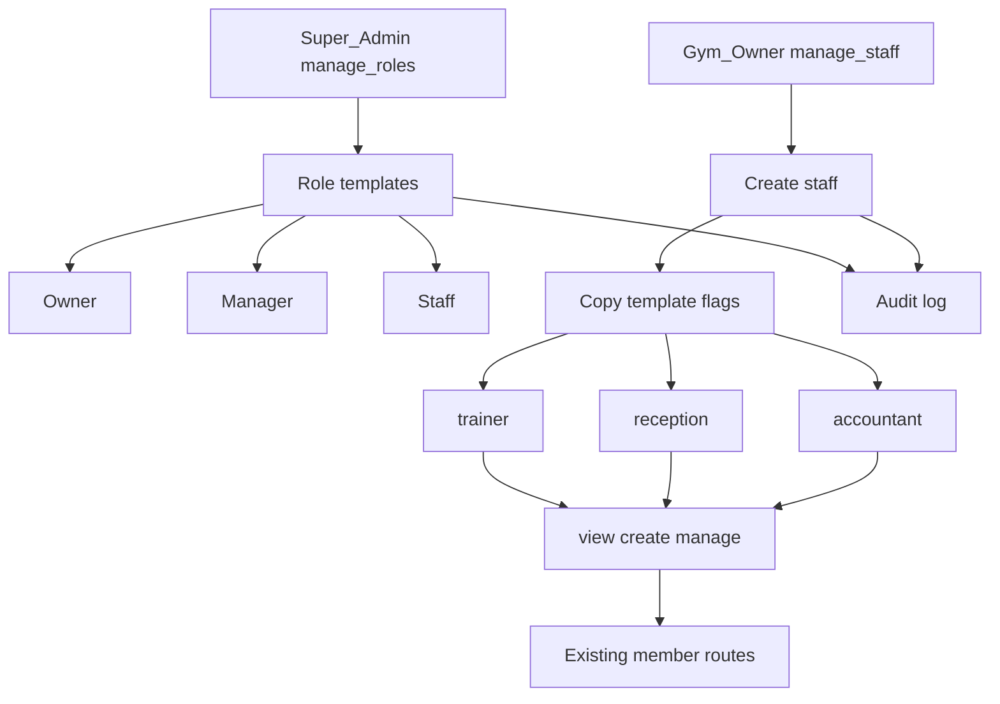

# Staff and Permissions Design

## Overview

Phase 4 adds one NestJS module, `src/modules/staff/`, to the existing ESM API. Super_Admin edits three Role_Templates with `manage_roles`. Gym_Owner creates Staff_Members with `manage_staff`. Each Staff_Member is a User_Account with the Role `Gym_Staff` and three flags copied from a template. Those flags gate the existing member routes. Template and staff writes append one audit row.

No package is added. Attendance, QR, branches, payroll, and a general audit system are out of scope.

Confirmed decisions and the testability rules are in `requirements.md`. The rules that were not drawn in the diagram, and that implementation will follow unless you change them, are:

- Templates are `Owner`, `Manager`, and `Staff`. They are not Roles.
- Titles are `trainer`, `reception`, and `accountant`. A title grants nothing.
- Seeded flags: Owner is view, create, and manage. Manager is view and create. Staff is view only.
- Flags are independent and apply only to member and membership-product routes.
- `maxStaff` is enforced on create and enable. Disabled staff do not use a seat. There is no delete.
- The audit log records template and staff changes only.

## Architecture

```text
src/
  common/constants/permissions.ts          (+ manage_staff)
  common/constants/role-names.ts           (+ gymStaff)
  common/guards/permissions.guard.ts       (staff flag check for member routes)
  modules/staff/
    dto/
    staff-values.ts                        (pure validation)
    staff.controller.ts
    role-templates.controller.ts
    audit-log.controller.ts
    staff.service.ts
    staff.module.ts
  modules/members/                         (gym lookup and decorator only)
  modules/auth/auth.service.ts             (disabled sign-in, /auth/me)
  modules/users/users.service.ts           (block staff role changes)
  infrastructure/database/platform-seed.service.ts
```

`StaffModule` imports `GymsModule` and `SubscriptionsModule` and exports `StaffService`. `MembersModule` imports `StaffModule`. `AppModule` imports `StaffModule` and stays a composition root. `PlatformSeedService.seed` creates the `Gym_Staff` Role and the three templates. `resetPlatform` already calls `seed` after truncate, so the templates come back without a second seed service.

Every staff handler uses `@RequirePermission('manage_staff')`. Template handlers and the platform audit read use `@RequirePermission('manage_roles')`. Owner identity comes from the session. The service loads the Gym with `GymsService.getMine` and then requires `status === 'active'`.



### Concurrency

Staff create and enable lock the Gym row inside one interactive transaction, the same way member create does:

```ts
await tx.$queryRaw`SELECT "id" FROM "gyms" WHERE "id" = ${gymId}::uuid FOR UPDATE`;
```

The transaction then counts Staff_Members of that Gym whose `disabledAt` is null, reads `entitlementsForGym(gymId, now, tx)`, and writes only when `maxStaff` is `null` or the count is below it. The second waiter recounts and returns 409 `Staff limit reached`. The User_Account, the Staff_Member, and the Audit_Entry commit together or not at all.

## Components and Interfaces

### Permission and role

Append `manage_staff` to `PERMISSIONS` after `manage_members`. Add `gymStaff: 'Gym_Staff'` to `ROLE_NAMES`. `PlatformSeedService` creates that Role next to `Super_Admin` and `Gym_Owner`, and adds `manage_staff` to `GYM_OWNER_ENABLED` only. The RolePermission backfill already skips existing rows, so saved states survive. `manage_staff` is not added to either Super_Admin lock set.

`enabledFor` returns false for `Gym_Staff` for every Permission. Seed creates a template only when its name is missing. It does not write over flags a Super_Admin has saved.

`UsersService.assignRole`:

- If the target User_Account has a Staff_Member row, throw 409 `Staff role cannot be changed` before any write.
- If `roleName` is `Gym_Staff`, throw the existing 400 `Role assignment is not valid`.

Registration is unchanged.

### Routes

| Route | Permission | Success |
| --- | --- | --- |
| `GET /role-templates` | `manage_roles` | 200 |
| `PATCH /role-templates/:name` | `manage_roles` | 200 |
| `GET /staff` | `manage_staff` | 200 |
| `POST /staff` | `manage_staff` | 201 |
| `PATCH /staff/:id` | `manage_staff` | 200 |
| `POST /staff/:id/disable` | `manage_staff` | 200 |
| `POST /staff/:id/enable` | `manage_staff` | 200 |
| `GET /audit-log?scope=platform` | `manage_roles` | 200 |
| `GET /audit-log?scope=gym` | `manage_staff` | 200 |

`GET /staff` is declared before `PATCH /staff/:id`. `:name` is the template name, not a UUID. `:id` is the Staff_Member UUID.

Member routes keep their paths and replace `@RequirePermission('manage_members')` with `@RequireMemberAccess(...)`:

| Level | Routes |
| --- | --- |
| `view` | `GET /members`, `GET /membership-products` |
| `create` | `POST /members`, `POST /membership-products`, `POST /members/:id/membership` |
| `manage` | `PATCH /members/:id`, leave, restore, `PATCH /membership-products/:id`, renew, switch, freeze, unfreeze |

### Authorization

`PermissionsGuard` reads the new metadata. When it is set:

1. No session: 401 `Authenticated_Session is required`.
2. Load the Staff_Member by `userId`. If the row exists and `disabledAt` is set: 403 `Staff account is disabled`.
3. If the row exists and is not disabled: allow only when that level's column is true. Otherwise 403 `Permission is disabled`. Do not consult `manage_members`.
4. If no Staff_Member row exists: require `manage_members` enabled, using the current RolePermission read. Disabled stays 403 `Permission is disabled`.

Gym status stays in the service, not the guard. A non-staff caller keeps the Phase 3 result, so the permission-enforcement property still treats `GET /members` as the `manage_members` route for a Gym_Owner.

`GET /auth/me` stays `@Authenticated()`. It does not use the staff check.

### Validation

`staff-values.ts` uses `classifyEmail` and `isAcceptedRegistrationPassword`.

- `fullName`: string, length 1 to 100, at least one character outside U+0020, tab, CR, and LF. Stored exactly.
- `title`: `trainer`, `reception`, or `accountant`.
- `template`: `Owner`, `Manager`, or `Staff`.
- `view`, `create`, `manage`: booleans when present.
- `password`: the registration password rule. It is hashed with bcrypt cost 12 and is never returned.

`parseCreateStaff` requires email, password, full name, title, and template. `parseUpdateStaff` requires at least one of full name, title, template, view, create, manage, and password. Both throw 400 `Staff values are not valid`. If template and any flag are both present, `parseUpdateStaff` throws that same error.

`parseTemplateUpdate` accepts one or more of the three booleans and throws 400 `Role template values are not valid` otherwise.

`parseAuditScope` accepts only `platform` or `gym`. Anything else, including a missing value, throws 400 `Audit log scope is not valid`.

### Service rules

Shared gym guard for staff methods:

1. `gym = gymsService.getMine(ownerId)`. Missing Gym stays 404 `Gym was not found`.
2. `gym.status !== 'active'` throws 409 `Staff management requires an active gym`.

`createStaff`: parse, reject an unknown template with 404 `Role template was not found`, then in a transaction lock the Gym, read entitlements, count rows with `disabledAt` null, and insert the User_Account and the Staff_Member only when allowed. Copy `canView`, `canCreate`, and `canManage` from the template row. Duplicate email is 409 `Email_Address is already used`, from the unique constraint, and the transaction stores nothing.

`updateStaff`: `updateMany` where `id` and `gymId`. Count 0 is 404 `Staff member was not found`. A malformed id is that same 404. Applying a template loads the current template and overwrites the three flags. A password update hashes the new password on the User_Account.

`disable`: set `disabledAt` to `now` only when it is null. Otherwise 409 `Staff member is already disabled`.

`enable`: 409 `Staff member is not disabled` when `disabledAt` is null. Otherwise lock, recount, and clear `disabledAt` only when the seat check passes. Failure is 409 `Staff limit reached`.

`gymForCaller(userId)`, exported for `MembersService`:

1. If the user owns a Gym, return that Gym. Owners are never staff.
2. If the user is a Staff_Member and `disabledAt` is set, throw 403 `Staff account is disabled`.
3. If the user is a Staff_Member, return that Gym.
4. Otherwise throw 404 `Gym was not found`.

`MembersService` uses `gymForCaller` instead of `getMine`. The active-gym error on those routes stays 409 `Member management requires an active gym`.

Sign-in, after the password comparison:

- Wrong email or wrong password, including a disabled account with a wrong password: the existing 401 `Email_Address and password do not match a User_Account`.
- Correct password and `disabledAt` set: 403 `Staff account is disabled`.
- Otherwise the existing token response. Flags are not checked.

`currentUser` adds `staff` only when a Staff_Member row exists:

```json
{
  "id": "…",
  "email": "ria@gym.test",
  "role": "Gym_Staff",
  "permissions": [],
  "staff": {
    "gymId": "…",
    "title": "trainer",
    "template": "Staff",
    "view": true,
    "create": false,
    "manage": false,
    "disabled": false
  }
}
```

Accounts that are not staff omit `staff`. Their current body stays as it is.

### Responses

Template:

```json
{ "name": "Manager", "view": true, "create": true, "manage": false }
```

The list is `{ "templates": [ ... ] }` in Owner, Manager, Staff order.

Staff:

```json
{
  "id": "…",
  "email": "ria@gym.test",
  "fullName": "Ria Sen",
  "title": "trainer",
  "template": "Staff",
  "view": true,
  "create": false,
  "manage": false,
  "disabled": false,
  "createdAt": "2026-11-22T10:00:00.000Z"
}
```

The list is `{ "staff": [ ... ] }`, ordered by `createdAt` then `id` ascending. `disabled` is true when `disabledAt` is not null. `template` is the template currently linked.

Audit:

```json
{
  "id": "…",
  "action": "staff_created",
  "actorEmail": "owner@gym.test",
  "targetType": "staff",
  "targetId": "…",
  "detail": {
    "email": "ria@gym.test",
    "fullName": "Ria Sen",
    "title": "trainer",
    "template": "Staff",
    "view": true,
    "create": false,
    "manage": false
  },
  "createdAt": "2026-11-22T10:00:00.000Z"
}
```

The list is `{ "entries": [ ... ] }`, ordered by `createdAt` descending then `id` descending.

Detail shapes:

| Action | `targetType` | `gymId` | `detail` |
| --- | --- | --- | --- |
| `template_updated` | `role_template` | null | `{ "name", "before": {view, create, manage}, "after": {view, create, manage} }` |
| `staff_created` | `staff` | gym id | email, fullName, title, template, view, create, manage |
| `staff_updated` | `staff` | gym id | `{ "before", "after" }` for fields that changed. A password change sets `passwordChanged: true` and does not include the password |
| `staff_disabled` | `staff` | gym id | `{ "email", "fullName" }` |
| `staff_enabled` | `staff` | gym id | `{ "email", "fullName" }` |

`targetId` is the template id or the staff id.

## Data Models

New migration `prisma/migrations/<timestamp>_staff_permissions`. Do not edit earlier migrations.

```prisma
enum StaffTitle {
  trainer
  reception
  accountant

  @@map("staff_title")
}

model RoleTemplate {
  id         String        @id @default(uuid()) @db.Uuid
  name       String        @unique @db.Text
  sortOrder  Int           @map("sort_order")
  canView    Boolean       @map("can_view")
  canCreate  Boolean       @map("can_create")
  canManage  Boolean       @map("can_manage")
  createdAt  DateTime      @default(now()) @map("created_at") @db.Timestamptz(3)
  staff      StaffMember[]

  @@map("role_templates")
}

model StaffMember {
  id         String        @id @default(uuid()) @db.Uuid
  userId     String        @unique @map("user_id") @db.Uuid
  gymId      String        @map("gym_id") @db.Uuid
  fullName   String        @map("full_name") @db.Text
  title      StaffTitle
  templateId String        @map("template_id") @db.Uuid
  canView    Boolean       @map("can_view")
  canCreate  Boolean       @map("can_create")
  canManage  Boolean       @map("can_manage")
  disabledAt DateTime?     @map("disabled_at") @db.Timestamptz(3)
  createdAt  DateTime      @default(now()) @map("created_at") @db.Timestamptz(3)
  user       UserAccount   @relation(fields: [userId], references: [id], onDelete: Restrict)
  gym        Gym           @relation(fields: [gymId], references: [id], onDelete: Restrict)
  template   RoleTemplate  @relation(fields: [templateId], references: [id], onDelete: Restrict)

  @@index([gymId])
  @@map("staff_members")
}

model AuditLog {
  id          String       @id @default(uuid()) @db.Uuid
  gymId       String?      @map("gym_id") @db.Uuid
  actorUserId String       @map("actor_user_id") @db.Uuid
  action      String       @db.Text
  targetType  String       @map("target_type") @db.Text
  targetId    String       @map("target_id") @db.Uuid
  detail      Json         @db.JsonB
  createdAt   DateTime     @default(now()) @map("created_at") @db.Timestamptz(3)
  actor       UserAccount  @relation(fields: [actorUserId], references: [id], onDelete: Restrict)
  gym         Gym?         @relation(fields: [gymId], references: [id], onDelete: Restrict)

  @@index([gymId, createdAt])
  @@map("audit_logs")
}
```

`UserAccount` and `Gym` gain relation fields only. Do not change existing columns. Append CHECK constraints because Prisma does not model them:

```sql
ALTER TABLE "role_templates" ADD CONSTRAINT "role_templates_values_check" CHECK (
  "name" IN ('Owner', 'Manager', 'Staff')
  AND "sort_order" BETWEEN 1 AND 3
);

ALTER TABLE "staff_members" ADD CONSTRAINT "staff_members_name_check" CHECK (
  char_length("full_name") BETWEEN 1 AND 100
);

ALTER TABLE "audit_logs" ADD CONSTRAINT "audit_logs_shape_check" CHECK (
  (
    "target_type" = 'role_template'
    AND "gym_id" IS NULL
    AND "action" = 'template_updated'
  )
  OR (
    "target_type" = 'staff'
    AND "gym_id" IS NOT NULL
    AND "action" IN (
      'staff_created', 'staff_updated', 'staff_disabled', 'staff_enabled'
    )
  )
);
```

`sort_order` is 1 for Owner, 2 for Manager, and 3 for Staff. The service does not accept it from clients.

The e2e `TRUNCATE` in `test/helpers/gym-platform.ts` becomes:

```sql
TRUNCATE TABLE
  "audit_logs", "staff_members",
  "membership_payments", "memberships", "membership_products", "members",
  "subscriptions", "plans", "gyms", "owner_profiles", "user_accounts",
  "role_templates", "role_permissions", "permissions", "roles"
RESTART IDENTITY CASCADE
```

`resetPlatform` already calls `platform.seed.seed()` after that, which must recreate `Gym_Staff` and the three templates.

## Correctness Properties

### Property 1: Seat limit blocks creates and enables only

For any `maxStaff` of `null` or a number from 0 to 5, creates and enables succeed only while the count of staff with `disabledAt` null is below a numeric limit, or the limit is `null`. A failed create or enable writes no User_Account, Staff_Member, or Audit_Entry. Updates and disables succeed when the count is already above a later, lower limit. Two concurrent creates at the boundary leave at most `maxStaff` active rows.

**Validates: Requirements 3.7, 3.8, 3.9, 4.7, 5.4, 5.6**

### Property 2: Template edits do not change stored staff

For any template flag change, every Staff_Member keeps the flags it had. A later update that submits that template name copies the template's flags at that later time. An update that submits flags and no template name does not change `templateId`.

**Validates: Requirements 2.4, 4.3, 4.7**

### Property 3: Staff flags stay inside one Gym

For any two Gyms and any combination of the three flags, a staff caller can call a member route only when their flag for that route is enabled, and only for their own Gym. A disabled staff caller is rejected. A Gym_Owner is still authorized by `manage_members` and is not affected by template flags.

**Validates: Requirements 5.8, 6.1, 6.2, 6.3, 6.4, 6.5**

### Property 4: Audit rows match successful writes

For any rejected staff or template write, the audit count is unchanged. For any successful write, exactly one new row exists, its action matches the write, and its `detail` has no `password` or `passwordHash` key. A template row has a null `gymId`. A staff row's `gymId` is the caller's Gym.

**Validates: Requirements 7.1, 7.2, 7.3, 7.8**

## Error Handling

| Condition | Status | Message |
| --- | --- | --- |
| Invalid staff field, update with no fields, or template plus flags | 400 | `Staff values are not valid` |
| Invalid template update | 400 | `Role template values are not valid` |
| Audit scope missing or not `platform` or `gym` | 400 | `Audit log scope is not valid` |
| Duplicate email | 409 | `Email_Address is already used` |
| Role assignment of a staff user | 409 | `Staff role cannot be changed` |
| Role assignment to `Gym_Staff` | 400 | `Role assignment is not valid` |
| Caller has no Gym | 404 | `Gym was not found` |
| Gym is not `active` on a staff route | 409 | `Staff management requires an active gym` |
| `maxStaff` reached, including 0 | 409 | `Staff limit reached` |
| Unknown template name | 404 | `Role template was not found` |
| Staff id missing, malformed, or not in this Gym | 404 | `Staff member was not found` |
| Disable when already disabled | 409 | `Staff member is already disabled` |
| Enable when not disabled | 409 | `Staff member is not disabled` |
| Correct password while disabled | 403 | `Staff account is disabled` |
| Wrong password, including while disabled | 401 | `Email_Address and password do not match a User_Account` |
| Staff flag off, or non-staff without `manage_members` | 403 | `Permission is disabled` |
| Permission missing, or no token | 403 / 401 | Phase 1 messages |

Member not-found and member-validation messages stay the Phase 3 strings.

## Testing Strategy

Unit tests cover `staff-values.ts` and `StaffService` with a mocked Prisma client and a mocked `entitlementsForGym`. Sign-in tests cover a disabled account with the right password and the wrong password. `currentUser` tests cover an account with no staff row, which must omit `staff`.

E2E tests use `test/helpers/gym-platform.ts` and the local embedded Postgres or `TEST_DATABASE_URL`. They never read `DATABASE_URL` from `.env`.

`test/permission-enforcement.property.e2e-spec.ts` adds `manage_staff: { method: 'get', path: '/staff' }` and keeps drawing from `PERMISSIONS`. A Gym_Owner with `manage_staff` enabled and no Gym receives 404, which is not 403, so the existing property still holds.

Add `test/phase4-examples.e2e-spec.ts` covering each error in the table once, a Gym_Owner whose member calls still succeed with `manage_members`, a staff caller blocked from `GET /roles` and `GET /dashboard`, and a template edit that leaves a stored staff row unchanged.

Properties 2 and 4 can be unit tests. Properties 1 and 3 are e2e tests.

## Phase 1, Phase 2, and Phase 3 impact

- `GET /roles` grows from 12 permission states to 13, and includes the Role `Gym_Staff`.
- `GET /users` can include staff emails with the role name `Gym_Staff`. The fields stay `email` and `role`.
- `GET /auth/me` adds `staff` only for a Staff_Member.
- Member routes use `@RequireMemberAccess`. A non-staff caller still needs `manage_members`. Request and response bodies of those routes do not change.
- `entitlementsForGym` is unchanged. Staff create and enable pass the existing transaction client.
- No Plan, Subscription, Gym status, or dashboard route changes.
- `AI_RULES.md` gains §65 during planning. The implementation tasks below stay open.
